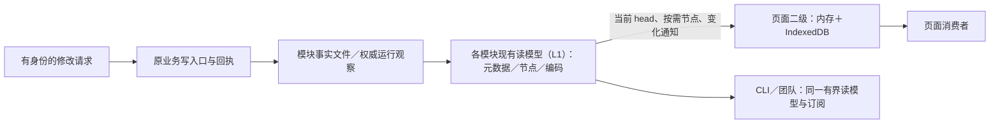
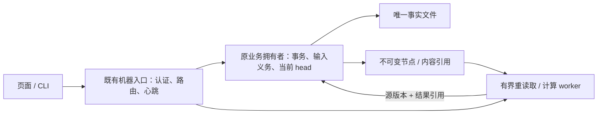

# GeneHub 分层文件、数据 hash 与事件 hash 统一同步提案

> 2026-11-15 文档迁移：保留原文日期、事实基线与评审状态；源码行号为历史定位。迁移范围及工作区资料说明见[提案目录](README.md)。

> 已被 [v4 统一信息同步架构](unified-state-sync-architecture-v4-20261108.md) 取代，以 v4 为实施依据。本文接口审查与实验证据保留为历史记录。

状态：综合提案已汇总，待评审实施；本次限定前置验证完成（14 项原型＋2 项现有 Host/WASM 基线通过），生产重构待实施。日期：2026-11-08。

本次汇总：采用 hash 主导的内容与缓存合同，修订／序号承担同步控制；明确公共接入、数据／动作／事件语义、批量读取和未来多进程边界。新增生产抽象尚未实现，隔离实验不构成生产协议或新 worker 的就绪证据。

2026-11-08 补充复核：多机页面按所需读取根独立准备和呈现；浏览器重开优先恢复本地完整视图；CLI 直接复用 daemon L1，不经过浏览器 L2。进一步对照 Git 后，撤回把业务同步单元做成独立注册／缓存状态管理的设计：公共缓存只管理不可变对象、结构引用、缺失获取和回收；来源 head 与查询／UI 语义各归原所有者。第 6.2–6.4 节是源码依据和待实施合同，没有新增生产实现或浏览器／CLI 性能跑测，既有原型数字不作为这些合同的通过证据。

交付范围：在 dev-3 保存可评审设计、协议／CLI／上下游审查和可复现实验；本轮不部署、不替换现有服务、不迁移用户数据。实验结果与尚未验证的生产假设分别记录。

## 用户问题与验收目标

用户在大历史、多团队和多机环境中遇到恢复慢、列表查询互相放大、项目移除等待。已知反馈中目录读取与手机恢复慢同时存在，但尚未证明单一因果。上一版增量覆盖会话与项目目录，重连仍上传已知对象清单，部分浅层接口仍构造深层历史。

例如：机器有一万条会话，用户关闭浏览器期间只改了一个标题。目标是重开时先展示上次状态，核对当前模块 head，只展开变化分支并取新摘要；不上传一万条 hash，不解码一万条正文，不把离线、未读取或坏文件当作删除。

Human 要求以四个核心重新设计：**数据分层；数据源自结构友好的文件；数据 hash；事件 hash**。协议、CLI 和消费者必须共同迁移，避免旧循环持续读全量。

## 推荐决策与本次验收范围

优先级是长期统一、可恢复和接入简单，接受适度 hash 计算、额外节点及少量冗余传输。hash 不是为本项目引入去中心化：各资源保持明确拥有者，内容摘要提供进程重启后仍可比较的身份，目录恢复不依赖永久变更日志。原子提交、输入义务和连接认证继续由原系统承担。

| 决策 | 带来的行为 | 代价及边界 |
| --- | --- | --- |
| 统一资源／表示／内容引用，以 dataHash 为缓存身份 | 页面、CLI 与未来 worker 使用相同读取规则；重启后内容不变可复用 | 首次读取、规范编码、hash 与空间回收有成本；hash 不替代事务或发现外部写入 |
| 目录按当前状态恢复，在线推送摘要与水位 | 长断线无需永久目录事件回放；最后一次通知丢失仍能核对当前 head | 在途快照和动作回执仍需有界保留；不能只说“无历史”就删除这些状态 |
| 逻辑分层、物理批量传输 | 一次可读一组节点，页面只展开实际需要的范围 | 允许附带少量已缓存兄弟节点；字节、条数、等待时间必须有界 |
| 源文件保持唯一事实，投影可丢弃重建 | 不再建立第二份业务目录数据库 | 现有事务文件先保留；Cloud SQLite 的权威迁移不混入本轮 |
| 数据接口不依赖进程内对象地址，重工作可放 worker | 为未来阻塞与故障隔离留接点，页面仍见一个机器入口 | IPC、资源竞争、所有权、取消及重启要验证；hash 本身不产生执行隔离 |

本轮交付完整设计、沿用逐族接口审查，并扩展真实文件／Node 子进程实验。生产阶段以会话与工作区两条链路先贯通公共机制，再扩展其他族；不会把两个实验文件 schema 写成现有 PageCatalog／Workspaces 已接入。

## 证据基线与交付边界

- 实验槽：`spaces/dev-3`，原双仓干净，原槽补丁经 `git cherry origin/main HEAD` 确认已在主干。
- 快进主干后的 Open：`a301ce11a496a93f090c6b9b5e401e719eee93cb`。
- 快进主干后的 Cloud：`e7dd53ea04bbddefcb6bf4622cc206b3312c7efc`。
- 原型与测试提交：Open `8543ae412a987a03451db05c8e3c8d1320657139`，精确 tree `dafd882e100b4d4498fbd216a101172ada9cfc95`；Cloud 未修改。提交仅含 4 个实验／测试文件，生产运行代码未修改。
- 本次扩展提交：Open `432e507fcba1007a7d8653fda197ecbf54a0b72c`，精确 tree `21e11f1c609dc2adc9b353fe7256ef1bfa207a75`，新增／修改 5 个原型与测试文件。review seal `sha256:867484c17a55b04bbd9320eef863c544675b520abca518c7f0a27ea9bcb72e64`；Cloud 仍为上述基线，apps/packages 生产代码未改。
- 初次实验的 run 记录绑定其提交前 HEAD＋dirty digest；初次审查 seal `sha256:5043131ea90ad5c0f2c55cf6e4d6dfb760e94db6b3ad038bed30e1c0b859e40f` 绑定初次 tree `dafd882e100b4d4498fbd216a101172ada9cfc95`。本次扩展的 run 与新 seal 归属见 7.2；均不自动迁移为新 SHA 的发布资格。
- 当前服务和用户 home 不作为实验数据源；实验目录、机器身份和数据由 testctl 隔离。
- 协议与代码审查清单、实验代码、实际 run 及结果见下文。接口命名若标为“拟议”，不代表已经可调用。

## 初始设计约束

1. 每项持久事实只有一个文件表达；已有 JSON、JSONL、blob、registry 和事务数据库的权威边界必须明确。
2. 小型对象头、集合清单、正文段和内容块分别读取；浅层读取不得内部展开全部历史。
3. 内容 hash 来自带类型、格式版本的确定编码；稳定 ID、内容 hash、发布序号分别承担身份、相等、新旧判断。
4. 大集合按稳定 ID 分桶；展示排序与查询视图不作为底层成员分桶规则。
5. 修改动作摘要（旧称事件 hash）绑定不可变请求与唯一 actionId；执行回执区分接收、提交、失败和未知。
6. 当前文件与当前清单足以恢复状态；不新增永久事件回放库，不假定外部副作用具有无条件 exactly-once。
7. PageCatalog、现有 blob／历史层、Client 生命周期、MachineSummaryDirectory 和浏览器持久缓存继续承担已有职责。
8. 先以隔离原型验证算法与真实文件成本；新机制尚未通过生产接口就绪门，原型通过不能替代 daemon／WASM／页面验收。

## 审查范围和已确认的问题

完整结果见 [协议／CLI／上下游审查附录](layered-sync-interface-audit-20261108.md) 和 [机器清单](evidence/layered-sync-interface-inventory-20261108.json)。本轮枚举了全部 **127 个 Request、27 个方法族、79 个已广告 CLI schema 名、9 种非 RPC stream method、52 个 Cloud 字面 HTTP 路由**。同时检查嵌套的 provider、preview feedback、client debug、AgentSpace 操作，以及 native CLI、`/cli` 和 Host/Relay 边界。79 不是完整 CLI grammar 数量；动态 Agent 动词、别名、native 命令另列。

这里的“全量”指接口声明与迁移表完整。各族的分发、状态所有者和关键上下游链路经过人工复核；没有将静态引用统计写成所有失败分支逐行审计，也没有声称 127 个操作均已实跑。

| 当前问题与体验影响 | 已确认的代码链路 | 拟改动 | 防复发验收 |
| --- | --- | --- | --- |
| 重连回包小，但上行与服务端仍处理整个已知读集 | `catalog.sync → known_sessions → catalog_row/summary_etag` | 当前 head＋分层清单比较；在线保留已有变化摘要推送 | 1 万行不变时只核对 head；单行变化不遍历重算全部行 |
| CLI 分页入口自动翻完；按项目也可能拉大量历史 | `query.rs:execute(SessionList)`；`SessionGet` 固定 `recent_rounds: None` | CLI 显式页、视图和续页合同，复用同一读模型 | 单页只取一页；有下一页不得报告完整／不存在 |
| 看状态或读一页，内部仍构造整个历史视图 | `read_view → clone → serialize → digest → page`；`history_snapshot → snapshot_for_open → window_snapshot` | 小型状态节点；叙事按段定位；摘要／正文依赖分开 | 状态查询不进入历史构造；末页读取工作量不随全历史增长 |
| 小目录变化导致浏览器来源级重新编码保存 | `MachineSummaryDirectory → writeDirectoryCache` | 同一目录所有者保存节点与覆盖范围，替换旧整来源写入 | 单对象变化只写受影响节点；配额、损坏、撤权后行为明确 |
| 浅层文件可能被错误拆成多个权威状态 | Store `SESSION_FORMAT=10` 的 meta 含 inbox、围栏、回执 | 保留原事务单位；只有实现整代文件＋原子指针后才拆分权威源 | 文件切换前后真实 kill；已接收输入和回执不丢、不重复 |
| Agent 可能将有副作用的命令当成纯读重试 | `query.rs:mutates` 对 workspace.open/add-root、file-access.configure 等返回 false | schema、命令行为和 retry policy 共用元数据；agent.test 也明确执行成本 | 对 schema 与真实磁盘／进程副作用交叉检查 |
| 大目录的部分结果被看作完整 | `file.tree` 2000/10000 上限；`directory.list` 截取 2000 | 分层清单带 truncated、unknown 与续读 | 超过边界、坏项、未展开和真实空目录可区分 |
| 旧团队仍反复查全量／深层状态 | `team.py` 全机 lean / inspect；`board.py` 周期 active；用户旧副本 | 原模板与已部署调用迁移到共享读模型与订阅 | 旧副本不因 CLI 收紧变“零任务”；空闲时无全量历史循环 |

这些是源码事实与设计风险，不能据此认定原手机断线已修复。旧方案中的完整活动读取、前台连接预留、正文 replay、Writer 字节预算、单会话写锁和墓碑已存在，继续复用。

## 1. 数据分层：统一节点合同，保留业务所有者

所有对外信息组织为“来源 → 模块 → 集合 → 对象 → 内容段／块”。每层都能独立读取、hash、声明完整性并观察变化；浅层成本不支付深层解码。唯一归属形成树，跨树关系用稳定 ID 引用，避免 hash 循环。



这张图不是新的网络拓扑：Client、endpoint、events、MachineConnections 仍沿现有路径；CLI 本地仍经 `/cli` 调 daemon 的原地 router，远端走现有 Fabric。服务端各模块拥有自己的事实，不建立一张再次复制全业务对象的全局数据库。

| 节点种类 | 事实来源／所有者 | 分层方式与写入约束 |
| --- | --- | --- |
| 工作区／Space／团队 | config registry、Space 描述文件、原协调器任务文件 | 项目头、成员引用、任务摘要；团队投影不能替代任务所有者 |
| 会话 | Store meta、chat、round/trunk/blob、Live | 摘要、待办／输入状态、叙事段、round/trunk、blob；保留现有读取引用与写锁 |
| Agent／模型／设置 | config、Agent 目录与 registry 状态 | 能力小头、配置视图、进程观察、操作回执；不把凭证放入共享节点 |
| 文件／Git／预览 | OS 文件、Git 工作树、已有 preview representation | 单层目录、文件头、按需字节／块、Git 观察；外部修改也必须使读模型失效 |
| 进程／PTY／Shell／语音／媒体 | 原生进程与对应服务 | 实例头、状态观察、流段、输出块；输入动作、退出与信令保留原时序语义 |
| 更新／设备／诊断 | 现有更新器、设备存储、诊断环 | 展示摘要可缓存；激活、撤权、票据不由旧缓存裁决 |
| Hub 账号与机器目录 | 当前 SQLite 事务和 Control 服务 | 作为独立权威服务提供结构化节点；不把 Hub 表复制成 daemon 文件事实 |

“所有数据可分层”不等于所有数据都要提前读取。日志与正在生成的正文按流／段／块分层，活跃段用现有序号与窗口，封存后计算块 hash；需要核对活跃内容时冻结有界窗口，不每 token 重算整份会话。

### 1.1 统一机制与最小业务接入合同（拟议）

统一的目标是：新模块接入后，页面与 CLI 自动获得相同的分页、完整性、缓存和恢复语义，业务无需各写一份 hash、缓存、订阅或重试状态机。接口声明清单已经覆盖全项目；各族适配器与生产故障矩阵尚未完成，不能据此宣称全面接入。

公共能力计划在现有代码中共享，职责归属如下。首期不另起同步服务或全业务状态库；后续可通过同一合同将有界任务交给 worker，详见 6.1。此处不是“现已实现公共内核”的声明。

| 公共能力 | 统一承担 | 业务仍须提供／现有归属 |
| --- | --- | --- |
| 节点与编码 | 确定编码、类型域、内容 hash、稳定分桶、字节预算与快照引用回收 | owning schema、稳定键、表示与成员规则；协议定义同源生成 TS |
| 变化发布与依赖 | 按提交结果更新受影响表示，维护发布修订，锁外发布；合并可覆盖的状态通知 | 原 Store／registry 的提交接点、原子修订与回执；PageCatalog／Workspaces 保留唯一读模型 |
| 读取与同步 | head/read/follow、快照与订阅交接、批量传输、游标、失步与末次更新恢复 | 模块提供有界读函数、源版本和 unknown 范围；复用 Client／endpoint／现有 events |
| 两级缓存 | 相同的对象格式、结构引用、hash 校验、缺失合并、配额、pin／驱逐与损坏恢复 | 业务生产者提供表示／查询结果根；来源 head 管新鲜度，UI 选择所需根；L1/L2 的缓存内核不理解会话、项目、活动等字段 |
| 动作包装 | 同一请求的身份与摘要核对、冲突／未知分类、回执查询及 CLI retry 元数据 | 原 typed command 校验和执行；持久回执与业务修改的原事务，不新建独立去重库 |

Rust 与 TS 共用协议、规范编码向量和行为合同；各自运行时实现不同，不把“同一机制”误写成已有一个可直接跨端执行的库。公共层也不再复制一份 PageCatalog 元数据或 Live 执行状态，只持有该所有者发布的必要节点、编码和引用。

模块接入分三组职责：

1. **声明资源。** 来源／所有者、稳定 ID、schema、summary/state/content 等实际支持的表示、成员归属和依赖。支持只读、可修改、带流等能力声明；缺失能力明确不支持。
2. **绑定读取。** 接入现有的有界读函数与版本边界。静态文件、事务记录、运行观察和追加流使用薄适配器；首次建立与外部变更发现沿该源现有发现／对账入口。公共层无法自动把一个全历史算法变轻。
3. **接好提交。** 可修改模块把原业务命令接到拥有者的事务，返回已提交的修订、回执与影响对象；只读模块无需实现写入。执行流沿原 seq/window、任务义务和执行者身份处理。

接入形态示意，以下名称是伪接口，不是现有可调用 API：

```text
resource session:
  source: existing Store + Live
  identity: existing session reference
  views: summary / state / content
  dependencies: session view dependencies
  read: existing bounded session readers
  mutations: existing typed session commands + their transaction
```

依赖只分两类：资源表示依赖哪些事实，以及成员变化影响哪个集合。改名影响该会话 summary 和所属集合，不重新构造正文；正文追加只更新内容段及确实改变的预览字段。业务声明字段依赖与动态关联对象，公共层据此传播；先提供小型显式表，不建立通用表达式语言或任意计算图。

写接点落在 Store／registry 等事实提交边界，不能要求每个 RPC handler 手动清缓存。涉及多个拥有者的操作保留原协调与失败语义，不能用一次跨模块 publish 冒充原子事务。模块声明只有在代码审查与实测确认所有实际写入口后才算完整。

提交与发布之间仍有崩溃窗口：持久事实及回执由原事务保证；L1 发布失败应使范围进入 dirty/unknown 并从事实重建，不能继续承诺当前。进程重启用新 epoch 重建或核对源版本后才开放 ready。公共失效通知允许合并，已接收用户输入与待执行义务保存在原 owning inbox／记录中；无需为恢复目录添加永久事件库。

共享实现的防复发合同在 M1/M2 验收，不要求各业务复制测试：至少用会话与工作区两个实际拥有者纵向接入，证明无需新写缓存／重连状态机；随后每模块只补源适配的特有事务、外部变化和消费者检查。公共合同覆盖不变核对、单改影响范围、订阅交接竞态、末次通知丢失、快照过期、回执重试、坏源 unknown 和撤权晚到写。字节与排队观测共用，业务仅提供来源与资源标签。

## 2. 结构友好的文件：读取边界与提交边界分别设计

已有会话物理布局已经按 meta/chat/round/trunk/blob 分层，不重建同用途文件系统。改造首先补齐仍在全历史构造的读取路径，并让新数据按其读取深度保存。现有 `docs/session-storage.md` 存在历史格式示例，最新格式以 Store 的 `SESSION_FORMAT=10` 为准。

读取形态示意：

```text
<owned-object>/
  <small header>                浅层事实或可重建的小头投影
  <child manifests>             ID 与内容引用；稳定分桶
  <content segments/chunks>     独立定位的正文
  <operation receipts>          原业务已有的义务／回执
```

不能立即把当前 `meta.json` 改成上述四个可独立改写的文件：它已经是输入义务、状态与回执的原子单位。第一阶段保持格式 10 权威源，只重构读模型。若测量证明冷读仍受大 meta 拖累，后续采用“先写好一代不可变文件，再原子替换一个当前引用”的存储提交：

1. 在现有写锁下核对预期修订与动作身份；准备本次变化涉及的文件。
2. 写入并按平台承诺同步内容；原子提交引用只指向完整文件集合。
3. 提交成功后更新 L1，再在锁外发布通知；通知失败由当前 head 核对恢复。
4. 未被提交引用使用的临时文件可清理；仍被在途快照引用的文件在预算内保留。

不同事实只保存一次：标题属于头部，正文属于内容块；派生摘要与目录 manifest 是可重建投影。文件名表达稳定 ID、类型、段号或不可变内容 hash；不把标题、瞬时运行状态塞进需要频繁改名的文件名。

源文件权威、缓存可重建并不等于零 I/O。第一次冷建需要读取事实；外部写入、复制、软链接、Git checkout 与跨渠道共享目录不能靠内部事件完全发现。watch／写后触发降低正常成本，共享对账负责补漏；mtime＋size 只可作为读取提示，不能作为无条件内容证明。阻塞在外接卷/TCC/网络盘的单个文件调用也不会被 Merkle 自动消除，必须有原服务的隔离、超时／可取消路径与未知状态。

Cloud 现有 SQLite 是结构化持久文件，但不是“list files 即发现业务对象”的目录布局。本轮不把数据库强改为 JSON，也不建立权威导出副本。若 Human 的最终约束包含控制面也必须使用目录对象源，必须另做账号／票据／撤销事务及备份恢复迁移；其未验证前是扩大覆盖范围的阻断项。

## 3. 数据 hash：确定表示、稳定成员树、可验证覆盖范围

拟议对象信封如下，payload 是生产者已编码字节的示意占位；其 wire 编码在 M1 与跨语言向量一起冻结：

```json
{"format":"state.object.v1","refs":["sha256:…"],"payload":"<producer-encoded-bytes>"}
```

`dataHash = SHA-256(domain + canonical(format, refs, payloadBytes))`。业务类型／schema／字段名属于生产者 payload，因此也被 hash 覆盖，但缓存不解释它们；生产者定义引用和 payload 的确定编码，通用层校验格式与字节。对象 ID 标识“哪个对象”，hash 标识“这一份表示”。相对时间、连接探测时间与业务字段分开；需要区分 ABA 或并发修改时使用修订，不拿 hash 做顺序判断。

持久回执若记录 afterHash，该值指向本次提交的业务数据视图；包含回执的提交描述再引用数据与回执。不能让回执包含“包含它自己的根 hash”。凭证原文及其可离线猜测的摘要不进入页面可枚举节点；完整连接和仅展示分享仍由现有认证、撤权和 OS 边界决定。

生产编码候选为 [RFC 8785 JCS](https://www.rfc-editor.org/rfc/rfc8785)，必须做 Rust／TS 同字节向量验证，包括键排序、非 BMP Unicode、控制字符、null／缺省、浮点和大整数。新接口中超出 JS 安全范围的计数／修订采用规范十进制字符串；旧协议字段在兼容适配中保留。当前 Rust ETag 与浏览器来源 checksum 各有用途，不能直接宣布它们已构成统一跨语言编码。

实验采用刻意收窄的 safe-integer JSON＋UTF-8 键序 profile，**不声称 JCS 合规**。其目的只验证结构、工作量与故障语义。浮点等被拒绝，不能拿 9 个通过项证明所有现有字段已可接入。内置 Agent 的 Cost 与远程桌面坐标确实含 f64；不是可以忽略的理论边角。

集合使用稳定 ID hash 前缀分桶；小集合一个节点即可，大桶达到字节上限才加深。不要按展示页序号或更新时间分桶，避免插入一行改变所有后续页。带排序／过滤条件的查询视图单独绑定源 head、query hash、snapshot 和 cursor，不能对每种查询预先维护完整副本。

每个 head 返回 owner、instance epoch、revision、representation hash、complete／unknown 范围与覆盖说明。顶层机器目录只汇集模块 head；不把它变成跨模块事务锁。一台机器不能核实的项目标未知，其余项目与机器继续可用。

集合快照承诺某次已发布视图的成员及引用一致，跨模块／跨机器只承诺各来源自己的版本和完整性，不宣称所有资源在同一物理时刻共同提交。确需跨对象原子效果时仍由原业务事务或协调器定义边界。

同一对象的 summary、state、content 是不同表示，分别有 head 与数据 hash。summary 的依赖只包括实际显示的字段和稳定内容引用，不引用整份活跃正文 hash；正文 token／段更新不应不断使所有目录摘要失效。需要核实完整对象图时可读取 full 表示，但目录订阅不跟随它的所有细节变化。该依赖切分尚未在生产实现。

源修订、进程 epoch 和连接水位放在 head／控制信封，只有属于某一表示业务内容的字段才进入其 dataHash。否则同样的标题内容也会因为纯传输状态变化而失去复用。旧原型 summary 直接使用整份 data，包含实验 revision，因此不能拿它证明所有业务表示均已按此切分。

## 4. 事件 hash：统一修改身份，不建立永久事件溯源库

### 4.1 数据、命令、事件与通知的区别

事件本身也可以序列化成文件或节点；区分依据是语义与承诺，不是 JSON／JSONL 形式。事件记录一旦产生，其自身内容不可变；一个长期执行动作的进度变化通过新的状态版本或新记录表达，不改写原请求的身份。

| 对象 | 回答的问题 | 身份与 hash／版本 | 保存与恢复规则 |
| --- | --- | --- | --- |
| 数据／状态表示 | 在某个版本，对象是什么？ | 稳定对象 ID、view、dataHash；源修订与发布版本分别标明 | 文件是持久事实，L1/L2 是可重建表示；运行观察带实例和新鲜度 |
| 命令／修改请求 | 调用者希望做什么？ | actionId＋动作参数摘要＋预期修订；重试复用整份请求 | 由原命令与 inbox／创建预留／回执接收；接收不等于业务效果已完成 |
| 已提交变化事件 | 拥有者确认发生了什么变化？ | 拥有者／epoch／发布序号、变化引用、新 dataHash；已知时关联 actionId | 由提交结果产生；状态订阅可恢复当前值，必达义务仍归原业务持久记录 |
| 失效／水位通知 | 哪个范围需要重新核对？目前发布到哪里？ | scope＋head／水位，不承担操作身份 | 可合并、可能重复；丢失后核对 head，不能作为提交或删除证明 |

回执属于**动作状态数据**：accepted 表示已接收的承诺，committed 表示该命令定义的持久效果完成；任务 accepted 不表示 Agent 已结束，更新请求 committed 也不自动表示服务已激活。后续执行结果继续沿原任务／更新器状态与完成回执核实。回执变化可以发布新的变化事件，但不需要创建第二套动作事实。

以会话从标题 A 改为 B 为例：

```text
请求：actionId=m1，rename(s1, B)，expectedRevision=8，动作摘要=D
原事务：保存标题 B、源修订 9 与 m1 的提交回执
发布：更新 summary 的 dataHash=HB 及受影响集合；发出已提交变化
页面：接纳正确来源／版本的节点，更新 L2 和列表
```

同一 m1 重发返回原回执；同一 m1 携带标题 C 拒绝；新的 m2 可以合法提出相同标题。若原命令失败，不能发布“标题已改为 B”。命令也可能产生零次、一次或多次后续状态变化；外部编辑器改文件可以产生观察变化，却没有本平台的 actionId，不能伪造原始意图。

用户原先的“修改动作 hash”与原型的 `eventHash` 实际指**请求的摘要**。原型及历史证据保留原符号；生产拟议命令统一称 `actionId/actionHash`，分别对应原型的 `eventId/eventHash`，避免把请求与结果混淆。数据 hash 与动作 hash 仍是两类主要摘要，使用不同类型域；已提交变化通常携带新 dataHash、发布序号和动作关联即可，本期不要求再建立独立事件哈希链。若后续确有校验独立事件记录的需求，另用明确的事件表示及类型域，不能复用动作摘要。

### 4.2 修改请求与持久回执

拟议不可变动作：

```json
{"schema":"mutation.v1","owner":"machine-and-module","actionId":"one-intent-id","target":"stable-object-id","operation":"session.rename","expectedRevision":"42","arguments":{"title":"new title"}}
```

`actionHash = SHA-256(action-domain + canonical(command))`；一次重试复用完整请求；相同意图参数、不同 actionId 是两次合法操作；同 actionId 更换参数须冲突。既有 messageId、creationId、provider actionId、uploadId 继续是原业务动作身份，通过适配关联 actionHash，不再发明另一套身份去重表。

动作绑定原 owning command；不存在一个能绕过业务规则的通用 `object.write`。回执至少区分 accepted、committed、rejected、unknown，包含对象修订、结果视图 hash 或结果引用；接收不代表 Agent 完成、进程已退出或服务已激活。外部副作用不能承诺通用 exactly-once；执行者有 durable receipt/fence 时复用，没有时断线结果未知并核实，禁止盲目重放。

平台外写文件只能生成“观察到前后差异”的事件，不能恢复没看见的中间动作或推断作者。数据／动作摘要不证明新旧，也不替代业务流 seq。离线恢复比较当前状态，普通目录通知可合并；用户输入、权限决定、任务结果依旧保留各自义务。回执按业务预算保留；过期动作重试须显式冲突或结果未知，不能自动当成新动作重新执行。

## 变化接点覆盖：不能只包 RPC

| 实际变化来源 | 当前所有者／接点 | 需要统一传播的内容 |
| --- | --- | --- |
| 元数据与持久输入义务 | `Store::save_meta`、inbox 接收／结算、creation reservation | 受影响的摘要、状态与回执；保留原子写入 |
| Agent 输出与执行状态 | `Live::publish`、round/trunk/chat 写入、取消与清理围栏 | 段／块变化与真正的状态变化；token 不触发全目录 |
| 工作区登记与 Space 发现 | Workspaces open/add_root/remove/configure、space_discovery | 成员关系与配置变化；别名／placement 按来源区分 |
| 协作协调器与超时 | coordination 文件、原协调器任务事实、投影过期 | 待办／未知与新鲜度；过期也会改变可展示状态 |
| Agent／模型／设置 | registry 生命周期、config 保存、provider operation | 能力集合、配置摘要及原动作回执 |
| 用户／Shell／编辑器／Git 改文件 | 文件服务＋共享发现／对账 | 路径层变化及相关表示失效；不能只监听 file.write RPC |
| 原生状态与实时服务 | Host 进程／PTY、service registry、语音／媒体回调 | 实例身份、状态观察、结束回执与流引用 |
| 预览与制品 | artifact finish、preview review／feedback、image representation | 完成发布的 manifest、源版本与批注修订 |
| 设备／Hub／更新 | 原设备存储、Hub generation 目录、更新器回调 | 展示节点与失效；不复制票据或绕过激活／撤权判定 |

每个接点在生产阶段必须有“拥有者、提交点、受影响视图、取消／崩溃路径、真实消费者”五项记录。缺任一写入口时，不能宣称该模块已完全事件驱动。外部写者仍由对账兜底，扫描／解码代价单独计数，不能归入“无变化核对零读取”而隐去。

## 5. 统一协议和 CLI 合同（均为拟议，尚不可调用）

共用读能力只需要三个逻辑操作，确切 Rust enum 名称在接口阶段定稿：

| 操作 | 输入／输出要点 | 接入位置 |
| --- | --- | --- |
| `state.head` | scope、view、可选已知 hash → 当前 head、未变化、完整性 | 现有 router／typed RPC；仅查已发布读模型 |
| `state.read` | snapshot、已给出的引用、maxNodes、maxBytes、可选有界展开深度 → 节点 pack、明确续读／过期 | 现有有限 Exchange 与 Writer；不增加连接 |
| `state.follow` | 批量 ref／有界查询请求、已知 head、可选初始视图及字节预算 → 登记 Ack；初始快照分块／完成标记，随后已提交变化与 head／失步 | 现有 SideEffect、SubscriptionTasks、events、Client 恢复生命周期 |

动作仍是既有 session/workspace/file/provider 等请求，逐族接统一 mutation 元数据与既有回执；不要同时新增泛型写 API 和保留一套独立去重写路由。只有已经注册的模块、schema 和 representation 可读；不能凭 hash 读取任意底层文件或扩大仅展示分享的范围。

快照／订阅交接沿现有先监听后确认时序，或在同一门内取得 head 并登记监听。发布序号判断落后；保活承载当前 head／水位，恢复入口核对遗漏末次通知。状态流丢失可以重建；正文流依旧使用 seq/replay/reset，不把它改成每个 token 更新全树。

快照完整性只证明“某一修订的数据齐了”。客户端同时记录已同步修订和最新已知 head；若同步期间又提交了变化，旧快照可以展示，但必须标旧并继续对账，不能标当前。原型补验已经实际捕获该错误，失败记录 `261108-1345-layered-sync-freshness-39d5` 保留；修复在原型完成交付后再核对当前 head，最终专项已验证旧快照标 stale、下一次核对收敛为 ready。

所有 pack 有条数与字节双预算。客户端按实际收到的完整前缀推进，explicit complete/cursor；单节点超过预算必须细分或明确报容量错。生产应支持有界 pack／初始快照流，在线通知可附带变化摘要；不能把原型逐层请求直接作为移动端最终实现。

首次视图可直接在 follow 中请求初始数据，head 并非每次必需的前置往返；read 留给未展开内容和失步补齐。快照固定／释放绑定订阅与有界传输生命周期，不照搬原型的四次独立控制调用。逻辑操作与网络往返、服务端数据帧分别计数；一个来源连接可承载多个读取根，冷同步不要求每个根各自建立连接。

CLI 保留熟悉的业务命令：

```text
genet session list --workspace <id> --limit 50 --cursor <opaque>
genet session get <id> --view summary
genet session get <id> --view state
genet session narrative <id> --limit 20 --cursor <opaque>
```

以上 limit/cursor/view 是拟议合同；当前 CLI 尚未实现 list 的这些字段。读输出统一包含 scope／view/hash、nextCursor、complete、unknown/truncated。游标绑定 authority、视图、查询与快照，换机器／换筛选须拒绝，过期明确要求重新建立读取。

持续状态由共享 Client／同一个目录所有者维护。团队脚本可经既有长驻协调器消费一次订阅投影；不让每个 shell CLI 实例另起同步 daemon、常驻全量索引或自己的 watcher。显式导出全历史属于独立有预算的流式任务，不能让普通 `--lean` 暗中翻完。

CLI schema 应由 owning command 同一份元数据生成 mutates、retry mode、default view、bounded/page/stream 与目标选择语义。Agent 只需“先列表摘要，需要时续页；按 ID 展开；执行修改后读原回执”。未知、未完成和错误均不输出伪装的空集合。

## 6. 两级缓存与多机恢复

- L1 仍归各业务模块的读模型，编码与 hash 随提交／变化更新；共享 node/manifest 算法，不复制 PageCatalog、Live 或 registry。in-flight 合并仍走现有 coalesce，不重复初始化。
- L2 仍归 MachineSummaryDirectory／现有工作台状态所有者，改为按节点与视图覆盖范围持久化；namespace 继续绑定账号、稳定机器身份、指纹和表示版本。撤权／退出清理保持现有代次保护，晚到异步写不能回填。
- 多标签页可以写相同的不可变节点，但当前根引用必须用 IndexedDB 事务核对后切换，避免旧标签页回写旧 head。分页／覆盖说明由不可变结果 manifest 承载，不在缓存中重复维护业务事实。同一来源实例内按发布序号比较，不同 epoch 先重新核对来源；客户端时钟不能决定哪个 head 更新。这部分尚未由 Node 磁盘副本验证。
- 缓存只承诺实际保留的分支。根 hash 相同可复用已加载范围，不能宣称整个对象图已在本地。读取时校验节点；损坏／驱逐触发该范围重新获取，配额不可用回退内存。
- 冷建、未知来源与完整活动集合有独立就绪状态。旧缓存标“上次状态”；一个来源离线不清空其他来源。连接轮转后也不能继续标实时。
- 每个对象有一个权威修改所有者，多页／多浏览器用该所有者修订冲突处理。复制项目形成新 placement，不把两个 OS 用户目录当成可无冲突多主写同一对象。
- head/pin/节点/回执均有容量与过期合同。过期快照清楚返回失效，客户端保留已确认内容并重新核对，不无限挂起或整机反复重连。

### 6.1 为未来 worker 准备的进程边界

现状依据：[Host 加载入口](../../apps/host/src/load.rs)、[guest 慢工作](../../apps/daemon/src/blocking.rs)、[Host 子进程接口](../../apps/host/src/process.rs)、[单实例](../../apps/daemon/src/run.rs)、[会话写锁](../../apps/daemon/src/session/store.rs)。Host 以 current_thread runtime 运行组件，guest 没有 blocking pool；单次同步文件操作返回前不能让出。Agent 已经能在独立进程运行，但目录、深层读取和投影仍可竞争同一 guest。单数据目录有唯一 daemon，会话还有独立内核写锁。

因此不把“多开完整 daemon”作为执行开关。拟议分工为：



1. **先分离读取与计算。** 扫描、历史解析、hash、预览可成为有界 job；原拥有者仍负责写入及发布。每种任务首先证明整体工作量已减少，不能让所有 worker 都冷建全机索引。
2. **前台入口保持一个机器身份和连接入口。** worker 不另注册成用户设备，不复制登录、票据和公网监听；对外请求仍经原 Client／Fabric。模块适配只选择执行器，页面与 CLI 不感知 PID。
3. **再评估会话所有权分片。** 只有重读取隔离仍不能满足前台响应时，才按会话组等边界划分拥有者。迁移必须等旧写者退出、获取原内核锁并核实在途义务；hash 不能裁决写所有权，也不新增租约服务取代内核锁。

公共任务信封拟议包含 `jobId`、任务种类、资源引用、输入 snapshot/head、拥有者及 worker generation、字节与时长预算。结果带同一身份、输入版本、输出引用与明确的 complete/unknown。最小生命周期为 accepted → running → result/failed/canceled；写动作的 committed 由原业务回执裁决，不沿用计算 job 的成功状态。

Host 提交必须快速返回 job handle；guest 从自己的事件循环等待通知／缓冲结果。不能把一段慢逻辑放到异步 Host import 后直接 await 到底，仍然停住整个 component。优先复用已有 Host 子进程启动、缓冲和回收能力；具体 job ABI、IPC 分帧与取消接线在生产实施前通过真实组件 smoke，Node fork 不代替该门。

输入用不可变快照或明确的源版本界定。旧结果即使 hash 正确，也可能基于已过时输入；拥有者发布前检查来源、实例／generation 和输入版本，过期结果可作旧缓存或丢弃，不能覆盖当前状态。源本身是 unknown 时不发布 ready。外部改写未被发现的窗口仍靠源适配与对账合同处理。

取消计算允许丢弃结果，必要时终止该 worker。修改命令断线、超时或进程死亡后，应先按原 actionId 查询持久回执；结果未知不得自动换 ID 重发。一个副作用跨多个服务时仍走原协调规则，不承诺 IPC 恢复就等于 exactly-once。

并发、待发／未取结果、IPC 帧、pin、内存与磁盘缓存均由公共执行器设预算；慢消费者触发背压或显式失步。后台逻辑 L1 可按拥有者分布，不意味着所有进程共享一个可变内存对象。不可变磁盘块可以复用，但各进程仍有内存成本。IPC 的目标是传引用和有界 pack，避免主进程重复解析完整历史。

公共 worker 监测至少记录队列等待、实际工作、IPC 字节、取消、重启次数及前台探针延迟。CPU／磁盘仍由同机进程竞争，进程数不等于可用容量。同 UID 的性能与故障隔离不增加新的产品 ACL 或安全租户声明。worker 入口和制品继续受原 ABI／签名／原生身份发布流程约束。

生产准入：真实 Host/WASM 下让 worker 长时间计算、挂起或死亡，前台及其他拥有者仍有界响应；重启后的旧结果不能回填；内核锁和持久回执证明不丢输入、不重复修改；IPC 退出、孤儿回收和所有预算有实测。通过后才能评价“多进程启用成本低”，当前只能说明设计留出了接点。

### 6.2 对象缓存与读取根（拟议；替代业务同步单元）

体验目标不变：机器 B 离线不挡住 A，未展开的文件树不挡住摘要，分包不让列表逐批跳变。上一轮把对象图完整性、查询覆盖、来源新鲜度和 UI loading 混入一份“同步单元”记录，虽能表达需求，却容易长成新的业务注册表和状态机。因此不实现独立业务同步单元管理器，改由调用方选择读取根；“单元”只保留为描述一次读取范围的非正式用语。

| 层 | 只负责什么 | 明确不负责什么 |
| --- | --- | --- |
| 公共对象缓存（L1/L2 共用合同） | 不可变编码字节、hash、显式结构引用；put/get/has、缺失请求合并、有界 pack、pin、损坏恢复与 GC | 项目／会话字段、排序／筛选、活动判断、分页含义、UI loading |
| 来源与 ref 同步（复用 Client／现有目录生命周期） | namespace、opaque ref 名称、rootHash、来源 epoch／revision；原子更新引用，推送／失步／离线与过期 | 不解释对象 payload；不另建每业务重试器或业务元数据副本 |
| 原业务读模型与消费者 | 从文件／Live 生成表示或有界查询结果；选择依赖／读取根，解释分页与未知，决定哪个区域能显示 | 不各写 hash、对象存储、网络恢复、驱逐或缺失合并逻辑 |

拟议对象信封只有格式版本、显式 `refs[]` 和 opaque payload 字节，hash 绑定整个确定编码。内核只解析这份结构信封，不遍历 payload 内的任意字段；生产者负责产生同源编码、类型和子引用。任意业务对象可作为叶，集合／结果 manifest 也是普通对象，均不需要向缓存登记 session、workspace 等业务类型。refs 只表达本次读取闭包必需的依赖；hash 本身不授予读取权限，仍绑定现有来源与连接。

拟议最小形状（不是已实现 API）：`Object={format, refs:[hash...], payload:bytes}`；`Ref={namespace, name, rootHash, epoch, revision}`。调用方经来源查询取得结果根，再执行 `ensure(rootHash)`；公共机制批量取缺失对象并返回有界进度。pin 是在途根的生命周期句柄，不是另一份业务状态。Rust／TS 共享格式与行为向量，各自实现运行时，不假称已有一个跨端可执行库。

不可变对象没有“任务状态过期”之类业务 TTL：hash 对应的字节不再改变，预算不足时可驱逐；需要重新核对的是 ref／来源观察是否仍为当前值。谁能生成正确视图、哪些字段变化影响哪个根，仍是业务生产者的职责，缓存不通过扫描 opaque payload 自动推断。

例如“项目 P 的前 50 条摘要”：原 PageCatalog 产出普通结果 manifest，payload 保存 query／snapshot／nextCursor／结果完整性，结构 refs 只指向本页摘要。缓存只把这张图补齐，不理解“50”“项目”或“下一页”。正文放在另一个读取根，摘要中的正文定位符不列入摘要初始化的必需 refs，否则通用遍历仍会把正文全部拉下；不靠缓存硬编码“遇到正文跳过”。业务知道需要什么，缓存只知道这些对象是否已在本地。

多机提供彼此独立的 ref，页面只等待当前区域所需根，不建立必须下载所有来源才能完成的全局根。UI 从读取句柄、来源状态和结果 manifest 推导显示状态，不再持久保存第二套覆盖／loading 事实。某根所需图齐了即可显示其快照；是否为最新另由来源 head 与订阅水位核对。命令回执和输入义务仍逐项处理，汇总不把未知来源当作零任务。

必须区分三个结论：**图完整**表示请求根的必需对象在本地且通过校验；**查询完整**表示生产者确认请求范围成功、是否还有续页；**状态最新**表示当前已知来源水位已接续。一个根 hash、一个对象存在或一个下载 complete 都不能同时证明三者。根切换、共享对象保留与驱逐属于通用图机制；源重启、新鲜度、查询失败与业务事务没有因采用 hash 而消失。

Git 的可借鉴边界是对象内容与树引用、独立的可变 refs，而不是理解源码业务；它仍解析 blob／tree 等结构类型，不能把“不懂业务”误写成“没有结构格式”。其 partial clone 专门处理按需缺失，对象存在不代表全部后代都在本地。[Git 对象](https://git-scm.com/book/en/v2/Git-Internals-Git-Objects)、[安全更新引用](https://git-scm.com/docs/git-update-ref)、[部分获取](https://git-scm.com/docs/partial-clone) 支持职责分离，不证明 GeneHub 已实现。无需提交历史、分支合并或永久目录日志，也不直接复刻 Git 的 promisor／pack 格式。

代码复核已足以确认需要收窄提案职责，不需另外构造一个独立缓存来证明层次划分。现有 prototype.mjs（历史文件：`genethub/prototypes/layered-file-hash-sync/prototype.mjs`；当前检出不存在） 的 `children()`／缓存遍历把 `summary` 当作叶，其他层从 children 取引用；这是结构分类，不能仅凭 summary 名称断定业务耦合。`syncReplica()` 本身不解释 title／name 等字段，两种资源已可复用，属于可继续提炼的基础；`readReplica()` 的 summary.data 解码应归消费者。未证明的是统一对象格式、任意关系形状及真实模块接入边界，不能把两个描述符的通过扩大为通用生产内核已就绪。原型保持历史证据，本轮不改写或重新宣称通过。

真正需要补的前置实验是：同一内核在不添加业务分支的情况下处理任意 payload 与三种关系图；两个根共享节点只获取一次；根存在但缺叶时保留旧视图；A 来源离线不挡 B；摘要根不会拉正文；配额驱逐／pin／重启后不会复用失效的闭包证明。随后才由真实 PageCatalog＋Workspaces／浏览器／CLI 证明接入成本和体验。本轮未执行这些新增实验。

已有页面证据：[MachineSummaryDirectory.follow/applyCatalog](../../packages/workbench/src/protocol/summary-directory.ts) 每批应用后 emit，完成后再 repairVisible；客户端已有来源状态和订阅。新的读取根规则应替换此发布边界，而非叠加一套同步器；原页面跳变的全部归因仍需逐帧验证。

### 6.3 浏览器持久缓存与重开顺序（拟议）

已有能力：[summary-directory-cache.ts](../../packages/workbench/src/protocol/summary-directory-cache.ts) 使用 IndexedDB，按账号／机器／指纹隔离，保存项目、活动摘要、最近至多 500 条历史与部分页校验信息，合并后会话上限 12,000；每来源编码预算 8 MiB，保留最多 16 来源，读取有效期 30 天。正文不在这份目录缓存中。存储失败回退已有网络路径，退出／撤权有清理和晚到写保护。因此并非没有利用离线存储，但也不是全部数据已可离线恢复。

当前缺口与替换位置：

- `refresh()` 先等待 `connections.targets()`，再取得 cacheScope 并加载来源缓存；没有独立的本地来源索引来支撑网络未就绪时的首屏恢复。网络目录不可达时，不能依这条路径承诺立即展示已缓存项目。
- 每次持久化仍按来源排序／序列化目录、重算 checksum、整份 put；300ms 合并写入减少频率，没有把成本变成单节点更新。落盘还受来源 `activityComplete` 门控制，不能表达某个项目视图已经独立完整。
- 写入主动丢弃 projectPages／nextCursor；页 ETag 只保留其所有行仍在缓存的视图。覆盖与续读恢复需要重建，不能从缓存行数推断集合完整。

改为下列启动和写入合同，替换旧来源整份写入，不双写两套缓存：

1. 在能确认当前本地账号范围后，从 IndexedDB 的有界来源／ref 索引恢复机器位置、上次视图根及所需对象；在线机器清单并行更新。索引只保存命名引用与来源定位，不复制对象 payload。不能确认身份时不套用另一个账号缓存；机器在线状态仍须联网核实。
2. 必需对象齐全的旧视图立即显示“上次状态”，联网后核对来源 head；缺失区域显示固定布局与读取进度。某机失败不清空其他来源。新浏览器只等待当前视图必需根，不下载所有历史；分页／未知等含义由视图 manifest 解释。
3. 接收的已校验对象可分批写入，以便中断后复用；所需图齐后，才用同一 IndexedDB 事务切换相应 current 根引用。结果 manifest 自身携带范围／续页信息，不再复制一份业务覆盖表。不同来源分别提交；撤权代次和同实例修订检查仍在切换前生效。
4. 调用方 pin 当前使用的根并给通用优先级提示，内核按字节、访问及引用可达性回收，不理解“当前任务／历史”分类。在用根超预算明确失败或缩小请求；驱逐、损坏后对应图成为 miss，不留下虚假的完整标记，不因根 hash 相同误报本地完整。配额失败继续使用内存，页面打开不以持久写入成功为条件。
5. 多标签页共享不可变数据，但不得回写旧 current；刷新、退出和撤权延续现有清理机制。此处不增加离线自动重放用户动作，输入与副作用继续沿既有命令／回执。

事务只保证该浏览器存储边界内的完整切换，不保证系统崩溃后所有写入永久存在；缓存仍可重建。参考 [IndexedDB 事务生命周期](https://www.w3.org/TR/IndexedDB/#transaction-lifecycle)。真实浏览器重开、配额、跨标签页和驱逐仍是生产门，Node 文件副本不能代替。

### 6.4 daemon L1 与大规模 CLI 消费（拟议）

现有方向可保留，但不能宣称已形成所有接口共用的低成本缓存：[PageCatalog](../../apps/daemon/src/session/store.rs) 已有唯一元数据表、排序／ID 引用、活动候选、写后登记与共享扫描；[catalog.sync](../../apps/daemon/src/session/catalog.rs) 修复仍对已知读集逐项投影／计算 ETag。CLI 的 `--lean`／`--active` 路径仍循环读取每页 100 条直到末页，轻量回包不等于轻量整次调用。

CLI 是一级消费者，不依赖浏览器在线或浏览器 L2。当前 [cli_front/rpc.rs](../../apps/daemon/src/cli_front/rpc.rs) 的本地调用直接进入同一 daemon router，已经共享运行状态，不会为每次本地业务调用新建第二个 loopback WebSocket；远端沿现有 Fabric。需要改读取算法和复用边界，不能把本地成本误归因于重复网络建连。

| L1 内容 | 维护与失效规则 | CLI／页面共同收益 |
| --- | --- | --- |
| 所有者的元数据及轻状态投影 | 文件提交／Live 或 registry 变化更新受影响表示；运行观察带实例和新鲜度；外部修改走共享对账 | 查状态跳过 read_view、正文复制和完整历史编码 |
| 内容节点、规范编码字节及 hash | 按表示修订计算并复用；不可变编码可共享，预算内驱逐后按需重建 | N 个读者不重复构造同一表示；正文 token 不导致全目录 hash |
| 有界查询视图／快照引用 | 相同查询与源版本合并在途构建；热门视图有限 memo，冷门按索引有界计算 | 一页读只处理必要候选；不为每种筛选预建全目录副本 |

这张表描述 L1 整体分工，不表示公共缓存要理解表中业务：元数据／轻状态和查询属于原生产者，公共缓存只持有它们生成的对象字节与 refs。变化依赖和“何时重建结果根”仍由 owning 读模型声明；通用对象层不会从文件字节自动推断哪个活动列表受影响。业务相关的生产与解释无法消除，能统一的是其间的缓存、获取和回收机制。

以上是各 owning 读模型上的共享规则，不再保存第二套 PageCatalog 或执行事实。发布失败把相关范围标 dirty／unknown 并重建；写操作仍在原 owning transaction 核实当前状态，不能以缓存 hash 判定任务可以安全执行。缓存命中也须遵守来源实例、覆盖和观察新鲜度，不能永久复用已结束进程的 running 值。

元数据索引、派生编码／hash、在途快照、正文块分别统计内存和驱逐预算。热门表示复用共享只读引用，正文按需缓存；不为每个读者克隆整套图。若基础目录超容量，明确分范围加载或报容量限制，不能静默丢成员仍承诺全量完整；派生节点驱逐只产生可重建 miss，不能丢持久输入或动作回执。

CLI 保持熟悉的 list／get／narrative，通过第 5 节拟议 limit/cursor/view 显式控制深度和范围；输出明确区分“本页已齐”“有下一页”“完整活动集合”“未知来源”。团队持续状态沿原长驻协调器消费共享订阅，不让每个短命 CLI 进程建磁盘 L2 或常驻全量 watcher；启动多个 Agent 不等于后台重复建多份索引。批量查询和同机多范围读取复用已有协议批次，不为统一形式再增一套命令。

并发 CLI、浏览器前台及后台重建共用既有 coalesce／工作预算和有界队列，缓存填充 single-flight；取消一个等待者不能取消其他仍需结果的调用。限制单客户端／范围的在途条数和字节，避免缓存命中后依然被序列化／发送队列淹没。普通前台与 Agent 短读均有进展保障，导出和冷重建走剩余预算；不靠无限排队或无限多进程解决负载。

新增生产验收如下，均尚未执行，不计入前述 14 项原型或 2 项 Host/WASM 已通过数字：

| 场景 | 可观察通过条件 |
| --- | --- |
| 三机中 A 可用、B 慢、C 离线；A 的正文或文件树未展开 | A 所需读取根独立可用，B/C 不阻塞；跨机汇总明确缺源，不能报告完整零任务 |
| 首次打开时分包／中途更新／最后通知丢失 | 当前视图依赖齐后统一呈现；同一源更新不漏；选择、输入与滚动锚点不因分包变化 |
| 实际浏览器 profile 关闭重开，先阻断在线目录，再恢复网络 | 已确认本地账号的完整旧视图在目录 RPC 完成前可显示为旧状态；未变范围不重传摘要，未缓存范围仍是未读 |
| 一个项目读取失败，但另一项目完整；中途关闭／配额失败／双标签页晚写 | 对象独立复用，各读取根分别提交；旧 current 保留，部分数据不伪装完整；旧实例／旧标签页不覆盖新引用 |
| 同一 daemon 上 1／20／100 个 CLI 读者与页面同时运行 | 一页只读一页，状态查询正文处理为零；同版本构建次数不随相同读者线性增长；记录队列、处理、编码字节、RSS 与前台 p95，对照现有版本，不以本机 Node 结果宣称性能提升 |
| 改名／正文输出／执行结束／外部文件改变与重启 | 只更新相关表示；本地与远端 CLI、页面得到一致含义；运行状态及时失效，错误不当成删除或空集合 |

## 7. 验证证据与解释

### 7.1 既有初始实验与产品基线

代码在 Open 原型说明（历史文件：`genethub/prototypes/layered-file-hash-sync/README.md`；当前检出不存在），测试在 9 项实验专项（历史文件：`genethub/testing/specialties/contracts/layered-file-hash-sync.specialty.ts`；当前检出不存在）。最终 run：`261108-1348-layered-sync-final-3a01`，**11/11 passed**（9 项原型＋2 项真实 Host/WASM 基线），`scope=feedback`，输入无漂移、每个用例清理后进程／端口 0。见 最终 summary（工作区资料：`spaces/dev-3/runs/261108-1348-layered-sync-final-3a01/summary.md`，未纳入本仓） 与 [有界机器证据](evidence/layered-sync-experiment-results-20261108.json)。

历史记录保留：第一轮 8 项通过（工作区资料：`spaces/dev-3/runs/261108-1333-layered-sync-experiment-0bfb/summary.md`，未纳入本仓）；首次真实基线 2 通过／2 未执行（工作区资料：`spaces/dev-3/runs/261108-1338-layered-sync-product-baseline-f530/summary.md`，未纳入本仓），原因是当时 I/O 预算 1 小于两项的声明 2，整个 run 为 blocked；新鲜度负向用例确实失败（工作区资料：`spaces/dev-3/runs/261108-1345-layered-sync-freshness-39d5/summary.md`，未纳入本仓）。最后调整资源预算并修复原型，只补齐尚未执行的真实基线，同时复验受共享 client 修复影响的 9 项原型；没有靠 resume 或重试抹掉失败。

测试是实际 Node 子进程、真实元数据／正文／缓存文件、实际原子替换与 SIGKILL；独立 Map／固定字节／磁盘结果作 oracle。不是 mock daemon，也不是生产 daemon 新协议。源记录带小型原子回执，L1 是内存节点图，L2 是 Node 磁盘副本；不冒充实际浏览器 IndexedDB。

| 指标 | 1,000 对象 | 10,000 对象 |
| --- | ---: | ---: |
| 正文 fixture | 4,096,000 B | 40,960,000 B |
| 冷建读取元数据 | 1,000 次／216,890 B | 10,000 次／2,178,890 B |
| 冷建／浅层同步读正文 | 0 | 0 |
| fixture 写入＋初次扫描耗时，单次 | 95ms | 824ms |
| 初始完整副本响应字节 | 436,327 B | 3,892,508 B |
| 初始请求数 | 26 | 170 |
| 不变核对请求／响应字节 | 27／211 B | 28／212 B |
| L1 不变核对读源元数据／算节点 hash／取节点 | 0／0／0 | 0／0／0 |
| 单改名更新 hash 节点数 | 4 | 4 |
| 单改名同步请求／响应字节 | 767／4,310 B | 775／7,594 B |
| 单改名同步请求数 | 8 | 8 |
| 等长扁平 known 提示参考字节 | 92,001 B | 920,001 B |

这些计数分别记录 L1 业务元数据读取、正文读取和节点构造，不包括目录枚举／marker、事件 digest、回执 afterHash 校验和 L2 对本地节点的校验。4 表示受影响的不同节点及其构造，不是整个系统所有 SHA 调用的总次数；无变化检查也不是“客户端零文件 I/O”。

扁平参考仅按同样数量 ID＋64位 hash 的 JSON 估算，不是抓包得到的生产 catalog 请求，不能写成“线上降幅”。正文 fixture 相同内容会重复，实验没有由此推导跨业务去重收益。上述毫秒数是本机 Node 单次值，不是 p95、公网恢复耗时或 WASM 性能。

独立故障结果：

- 相同 event 重试只提交一次；相同标题、新 event 正常提交；同 ID 换参数冲突；42 次真实提交后只保留 32 回执，过期旧请求由修订冲突阻止重做。
- 在 rename 前、rename 后实际 SIGKILL 并重启：分别保留旧记录或完整新记录；重试最终均为修订 1、一份回执。没有测试电源故障或跨文件事务。
- 坏源文件在冷／热启动均标未知，缓存不因缺失被删；修复后恢复。外部新增／删除通过显式 scan 发现，该扫描成本明确计入，原型没有 OS watcher。
- 100 行旧快照在新提交后仍可读取；第 9 个 pin 明确拒绝；过期 pin 明确失效；80 次更新并释放 pin 后 resident node 保持 194，没有积累旧路径。
- 进程重启后 epoch 改变、内容 root 相同，不重传节点；损坏副本在读取边界检出并修复；其他 authority 拒绝使用同一缓存。
- 独立模型推进 120 次变更、期间跳过同步，最后无新事件时核对 head，副本收敛为 54 个正确成员，删除项不复活。
- 同步途中实际提交第二个版本：原 pinned 快照仍内容一致，但返回 stale；后续无新事件也能核对最新版本并恢复 ready。该用例先失败、修复后通过。

真实产品基线也实跑：当前 daemon 一万条元数据、130 条较早活动均完整；缓存过期后的活动读取单次 2,188ms，热读 88ms，daemon 重启后冷恢复 3,356ms。目录条件修复中，在线改名只变化 1 行、不变重连与 daemon 重启均重传 0 行，关闭期间的改名 1 行和删除 1 项正确补齐。分页兼容与 CLI discovery 在前述 blocked run 中已分别通过并清理正常，不将整个 blocked run 改写为通过。这些现有生产接口结果不是新原型接入生产的证据，也不能与不同 fixture 的 Node 耗时直接计算性能倍数。

**实验推动的设计收窄：** 保留 hash 分层，但不直接照搬原型的传输与存储。加上最终新鲜度核对后，冷同步 170 次、差额 8 次串行请求说明 RTT 是独立成本；生产要结合现有摘要推送、有界 pack 和只读可见范围。大量不可变小缓存文件还需要实际 IndexedDB 与空间回收验证。原型两级固定分桶只证明一万条 fixture，不能据此承诺任意容量。

### 7.2 本次有界 pack、适配与 worker 前置验证

最终原型 run：261108-1513-layered-sync-worker-final-0b3e（工作区资料：`spaces/dev-3/runs/261108-1513-layered-sync-worker-final-0b3e/summary.md`，未纳入本仓），**14/14 passed**，输入无漂移，`dev-feedback/scope=feedback`；每项清理后进程／端口均为 0。[机器证据](evidence/layered-sync-worker-results-20261108.json) 保留原 qualification 与源码／产物绑定，不能解释为 merge、dev 体验或发布资格。

完整保留 首轮失败 run（工作区资料：`spaces/dev-3/runs/261108-1512-layered-sync-worker-preflight-880a/summary.md`，未纳入本仓） 和 [失败摘要](evidence/layered-sync-worker-failed-20261108.json)：12 通过、2 失败，均为缓存恢复路径请求了新 pin 尚未引入的子节点。修复让没有完整子树证明的缓存父节点重新通过新快照读取，继续保留服务端范围检查；不是放开任意 hash 读取，也不是自动重试洗绿。

| 同一源、两个独立空缓存的实际测量 | 1,000 条 | 10,000 条 |
| --- | ---: | ---: |
| 原 nodes 路径冷同步请求数 | 26 | 169 |
| 新 pack 路径冷同步请求数 | 9 | 35 |
| 原路径冷同步上下行字节 | 86,928 / 436,326 | 709,131 / 3,892,448 |
| 新路径冷同步上下行字节 | 85,299 / 435,400 | 844,765 / 3,885,074 |
| 新路径不变核对：请求数、响应字节 | 1，211 B | 1，212 B |
| 新路径单改名：请求数、上下行字节 | 6，525 / 24,130 | 6，531 / 40,654 |
| 最大含保守信封的 pack 字节 | 130,891 | 130,985 |
| 单 pack 最大节点数 | 430 | 429 |

pack 限制为最多 512 节点／128 KiB，并可展开一层。通过完整 fixture ID／标题检查，无遗漏、重复；不变核对 L1 源元数据读取、节点构造、正文读取仍为 0。此次旧路径 169 次与早期 170 次相差一个分包，是新读遍历与帧边界的结果；对照采用本次同一源的两条路径，不混用历史数字计算改进。

收益与代价都明确：冷请求数显著下降，但万条冷同步上行增加约 19%，单改名响应由旧路径约 7.6KB 增至约 40.7KB；有界冗余换取更少往返符合本次取舍。计数来自本机 NDJSON 传输，没有模拟公网 RTT、手机首屏或计算端到端加速倍数。全副本 35 次仍不是页面首屏合同；生产必须按视图覆盖范围加载并复用现有推送，不将整个副本作为页面就绪前提。

两个文件描述符复用同一索引、原子回执与 replica：session 使用 title/body，workspace 使用 name/rootHandle，未声明的 body 表示明确拒绝。200 条 workspace 的一次中断保留旧完整缓存，续接后得到全部正确成员与新名字。下载节点与完成证明分开，只有整个所需快照闭合后才发布完成标记和 current 引用；Node 的空 `.complete` 文件是实验表达，实际浏览器应通过图校验和根引用事务维护通用完整性，业务覆盖仍归结果 manifest，并验证配额与回收。该实验不代表实际 Store 与 Workspaces 已被适配或已实现业务无关内核。

worker 实验程序见 workers.mjs（历史文件：`genethub/prototypes/layered-file-hash-sync/workers.mjs`；当前检出不存在），专项见 本次 5 项（历史文件：`genethub/testing/specialties/contracts/layered-sync-preflight.specialty.ts`；当前检出不存在）。实际创建一个 Node 入口和两个子进程，分别拥有隔离 Laboratory 源；入口只缓存 head、任务和结果引用。工作负载为受控 SHA 计算及结果交付延迟，没有 mock 生产 daemon。

- 同样 1,200ms SHA 工作放在入口时，一次探针等待 1,151ms；移入 worker 后，10 次入口探针 p95 约 1ms。CPU 工作实际执行，并非只用 sleep；该 p95 仅是本机小样本，不是生产性能承诺。
- 实际 SIGSTOP 一个 worker，入口 PID 保持，另一拥有者仍能提交修改；取消停止的 worker 并重启仅改变该 worker generation。没有把用户机器上现有 daemon 当作故障目标。
- 在投影准备后实际修改源，再延迟交付旧结果：旧结果标 stale，不发布；新投影正常发布。结果示例仅 637 B，不传整份历史，输入／输出 hash 不被当作新旧顺序。
- 两个活动 job 已满时第三个明确拒绝；重复 jobId 拒绝；取消后不接受晚到结果，完成记录可显式释放，保留上限 16。尚未验证所有生产 IPC 缓冲、TTL 和压力下的内存预算。
- 在真实 atomic rename 后、回包前 SIGKILL worker：磁盘已为修订 1、一份回执；入口报告结果未知且存活；新 generation 上用原动作重试返回同一回执，磁盘仍为修订 1。

这些是 Linux、Node 子进程、原型源格式的证据。新 Host job ABI、WASI 阻塞源取消、真实内核锁交接、实际 IndexedDB、多平台和全部业务适配仍没有由此获得验证。

补偿性真实产品基线：261108-1517-layered-sync-host-baseline-0d0c（工作区资料：`spaces/dev-3/runs/261108-1517-layered-sync-host-baseline-0d0c/summary.md`，未纳入本仓），**2/2 passed**，输入无漂移、清理后进程／端口均为 0；见 [机器证据](evidence/layered-sync-host-results-20261108.json)。真实 Host/WASM 在长 Shell 等待期间，第二连接的 workspace.list 满足现有用例 2 秒门槛；杀死 Agent Host 后当前 turn 明确失败／取消，未误报完成。它们证明现有进程边界可复用，不证明新 worker ABI、同步协议或真实阻塞文件取消已经实现。

本次两个最终 run 都绑定提交前 Open `8543ae41`＋各自记录的 dirty digest，候选内容由上述精确 tree 与审查 seal 保存；不把提交后的新 SHA 自动升为既有 run 的发布资格。tsc、两个 `.mjs` 语法检查、testctl lint/governance、diff 检查通过，治理文件未修改。早期 4 项目录／CLI 产品基线继续作为生产现状参考，没有在本轮重跑无关全套。

### 7.3 生产实施前的证据分界

| 问题 | 本次能回答 | 仍须由生产纵向试点回答 |
| --- | --- | --- |
| hash 是否能统一两种资源并减少重复内容读取 | 实验描述符与同一 replica 可以；不变核对不读源 | 真实 PageCatalog／Workspaces 接入是否仍需独立缓存或恢复器 |
| 是否必须维护永久目录回放日志 | 当前状态树能修复实验副本，含最后安静更新 | 在线订阅交接、真实队列溢出与旧端兼容 |
| 是否可以牺牲部分带宽换简单批量 | 本次较少请求、受控冗余且逐包有界 | Fabric／移动网络与只读可见范围下的前台延迟 |
| 单进程阻塞是否能通过 worker 缩小影响 | Node 入口与另一拥有者在 CPU／SIGSTOP／SIGKILL 下可用 | 真实 Host/WASM 的新 job handle 接线、文件阻塞和资源争用 |
| hash 是否替代版本、事务、动作身份 | 不能；旧结果与回执用例依赖这些边界 | 跨模块事务和所有有副作用命令的逐族矩阵 |
| 方案是否已具备全面发布条件 | 否；这里只完成提案和限定前置证据 | M1–M5 各自门禁、三平台、浏览器及原设备验收 |

## 8. 迁移里程碑、替换范围与回滚

替代方案比较：

| 选择 | 适用与代价 | 本提案决定 |
| --- | --- | --- |
| 保留每对象 ETag＋known 清单 | 最少改动；恢复上行和逐项比较随读集增大 | 小集合仍可用，避免为几十行固定构造深树 |
| epoch／revision＋有界变化窗口 | 单拥有者下初期接入简单；窗口失效或重启后需重新核实范围，或持久维护更多版本状态 | 作为可行替代保留；本次按 Human 的长期统一优先级，选择内容 hash 作为缓存身份，序号仍承担控制；没有无 hash 同场性能对照，不宣称 hash 必然更快 |
| 持久 change feed／事件回放日志 | 短断线补齐直接，但要保存历史、处理截断与重启 | 当前目录不引入；已有正文 replay 保留 |
| 当前状态的分层 hash 清单 | 长断线不依赖旧服务器根；可跳过不变分支，但增加节点、编码和 RTT | 作为大集合统一基础，配合推送、有界 pack 和按需覆盖 |
| 业务同步单元注册＋缓存状态机 | 可直接表达每种业务的加载／覆盖，但易与查询和 UI 重复维护事实 | 不采用；统一对象图与 ref 获取，查询 manifest 和消费者保留语义，只按所需根读取 |
| 全平台事件溯源／多主合并 | 要求更多历史、冲突与事务机制 | 当前需求无需将其设为基础；写归属和原业务规则保持明确 |

方法参考：[Git 对象与树](https://git-scm.com/book/en/v2/Git-Internals-Git-Objects)、[IPFS Merkle DAG](https://docs.ipfs.tech/concepts/merkle-dag/)、[Syncthing 索引增量](https://docs.syncthing.net/specs/bep-v1.html#delta-index-exchange)、[Kubernetes 快照与 Watch 恢复](https://kubernetes.io/docs/reference/using-api/api-concepts/#efficient-detection-of-changes)。这里采用内容／目录引用、缺失数据按需获取和失步可恢复原则；这些资料不替代本项目的实现及验收证据。

原子切换参考 [Nix generations](https://nix.dev/manual/nix/2.32/package-management/profiles)，请求身份与参数核对参考 [AWS 幂等请求](https://aws.amazon.com/builders-library/making-retries-safe-with-idempotent-APIs/)，主入口与工作进程分离参考 [Chromium 架构](https://www.chromium.org/developers/design-documents/multi-process-architecture/)。[RFC 9110](https://www.rfc-editor.org/rfc/rfc9110.html#section-8.8.3.1) 明确 ETag 可以采用修订号或内容摘要：统一的是校验合同，采用 hash 是本项目当前的取舍，而非标准强制。

| 阶段 | 可独立交付的结果 | 同步移除／替换的旧路径 | 进入下一阶段的门 |
| --- | --- | --- | --- |
| M0 本轮 | 可评审提案、接口审查、隔离原型与基线证据 | 不替换生产路径 | 列清所有待验证项；不授予发布资格 |
| M1 统一合同 | Rust owning schema、生成 TS、canonical profile、资源／表示／动作 metadata、共享同步行为合同 | 重复手写 schema／分类表改由同源生成；原型 eventHash 的动作语义在接口命名时明确 | 跨语言向量、协议兼容、真实 artifact 接口 smoke；生产入口就绪 |
| M2 目录贯通 | PageCatalog＋Workspaces 两个实际拥有者接同一对象／ref 机制；按读取根独立呈现；CLI 单页／轻状态；浏览器优先恢复对象缓存 | known 全表核对、重复补页／轮询、整来源重复缓存写入及依赖在线目录的恢复顺序；不增加业务同步单元注册或第二份缓存 | 原设备恢复与大历史／多机／旧 daemon 回归；第 6.2–6.4 节业务无关图内核、实际浏览器重开和多 CLI 并发通过；不丢活动义务 |
| M3 历史与调用方 | 叙事／round 按段读取；团队／看板共享状态 | read_view 全量编码后截页、高频 inspect、旧模板全机轮询 | 长历史实际处理量、分页边界、旧部署副本迁移、重建语义不退化 |
| M3 后的隔离试点 | 将测得仍阻塞前台的有界读任务接入 Host worker 执行器 | 替换对应 guest 内阻塞任务；不并行运行第二套同用途后台扫描 | 真实 ABI、异步 job handle、背压／取消／重启／旧结果门；保留原写拥有者和入口，尚不分片会话写入 |
| M4 扩展所有模块 | Agent／配置／文件／Git／进程／更新等摘要接同一读合同 | 每个被替换的 polling/cache 分别退出 | 每族真实读写／回执／外部变化验证；不能只复制类型 |
| M5 必要的源格式调整 | 可恢复的整代文件＋原子引用 | 仅替换已证明为热点的原子记录格式 | 跨渠道锁与旧读写版本门、三平台崩溃恢复、迁移／备份／回滚 |

M1–M5 是待实施重构，不是本轮完成承诺。每阶段按实际受影响模块选择完整 policy，不用本轮限定专项冒充 merge/dev/Beta/Stable gate。

旧客户端／旧 daemon 经 feature 协商保留原入口；同一消费者只启用一条同步路径，不能新推送和旧轮询永久并行。新增业务字段与能力不自动改变 carrier；需要不兼容解码或存储语义时显式升 owning 版本。任意新 ServerFrame 只发给已 opt-in 的 peer，不能破坏旧端 events 解码。

源格式迁移前保留只读适配，禁止新旧格式双主写。旧版本会误读时升 SESSION_FORMAT；不能靠可丢缓存修补被旧写者覆盖的事实。回滚可以丢 L1/L2 重建；已写新格式的权威数据须有已验证逆迁移或保持只读，不能假称回退二进制即可恢复。部署和 App 签名／ABI／原生身份继续按原发布流程独立验收。

## 9. 必须关闭的未决项与生产验收

| 未决项 | 当前证据 | 关闭条件 |
| --- | --- | --- |
| 全字段 canonical 表示 | 原型仅整数 profile；现有协议含 float／u64 | Rust/TS 同字节黄金向量、所有字段域分类、未知类型拒绝 |
| 低 RTT 与按需范围同步 | 本次同源对照冷同步169→35次、单改8→6次，代价是有界冗余；仍是完整副本 | 在现有 Fabric 测首屏、重连、单改与密集改；记录请求数、上下行、前台 p95 |
| 实际浏览器持久化 | 现有产品有按来源 IDB；新原型是 Node 磁盘副本，未验证通用对象／ref 持久化 | 真浏览器关闭重开且在线目录受阻时先恢复；各根分别提交、驱逐、损坏、配额、撤权和晚到写；部分范围不冒充完整 |
| 读取根与页面发布 | 已复核逐批 emit 与补页路径，未实测原页面跳变归因 | 三机独立就绪、范围／表示分别加载、初始化和订阅交接、输入／滚动位置稳定；没有整页等待所有来源 |
| 缓存内核的业务无关性 | 原型以统一叶／树结构同步两种 payload，syncReplica 不解释业务字段；统一格式与真实适配尚未认证 | opaque payload／显式 refs 图无需业务分支；共享对象只取一次，缺叶不切根，摘要不拉正文，驱逐不留下虚假完整标记；公共层不重复解释分页／活动 |
| L1 与 Agent 高频 CLI | PageCatalog／本地 router 共享已存在；自动翻页与逐项投影仍有放大 | 真实 daemon 的 1／20／100 读者混合页面场景；单页／轻状态处理量、构建合并、字节和内存预算，以及前台 p95 同源对照 |
| 原子拆源与跨渠道 | 单文件 atomic rename kill 通过 | 现有内核写锁保留，整代提交跨文件 crash矩阵；Win/mac/Linux 文件系统验证 |
| 外部变化发现 | 显式 scan 能修复，代价非零 | 所有写入口接点表；watch 丢失、同时间戳改写、软链／复制／删目录、离线卷；对账预算 |
| WASM 调度与阻塞源 | Node进程隔离及两项现有Host/WASM基线通过；新worker与阻塞文件仍未接入 | 真实 guest 计工作、排队、yield wait、锁持有和前台恢复，确认单次 I/O 不无限阻塞 |
| 缓存空间与生命周期 | L1 旧路径引用回收通过；L2 无 GC | pin、body、节点和浏览器持久缓存的字节预算、驱逐与取消测试 |
| 写动作覆盖与外部副作用 | 原型 rename/archive/逻辑 delete；部分生产动作已有回执 | 逐族重试／冲突／未知／取消／重启矩阵；禁止用通用 hash 声称 exactly-once |
| 公共机制的实际接入成本 | 两个实验文件描述复用同一内核与replica；不是实际模块适配或通用生产 SDK | 会话与工作区真实接入复用同一同步行为；各族写入口完整，源事务不破坏；无重复业务缓存／恢复器；后续流与运行观察接入保持原时序 |
| worker 执行与拥有者分片 | 当前源码已有子进程与内核写锁；本次隔离实验只建 Node 入口／workers | 新 job ABI 经真实 Host/WASM；阻塞与死亡不影响前台；进程／队列／字节预算及孤儿回收；后续写拥有者迁移另验，不能移除 SingleInstance 直接多开 |
| 物理删除和内容 GC | 原型只删除成员，保留实验记录 | 已删除会话内容清除、引用与在途读取、锁持有者、缓存清理均按现有合同验证 |
| Hub 文件源约束 | 当前权威是 SQLite；已有 hash/revision | 是否迁移存储独立决策；若迁移须证明事务、认证／撤销及恢复，不复制双事实源 |

结论：四个核心可以作为统一数据访问与同步的架构约束；当前原型证明了受限条件下的收益与恢复性质，也暴露 RTT、存储原子性和覆盖范围的额外成本。进入生产实施应先完成 M1 的接口就绪与编码合同，再做 M2 纵向贯通；不能以本轮数字批准一次性全平台替换。
