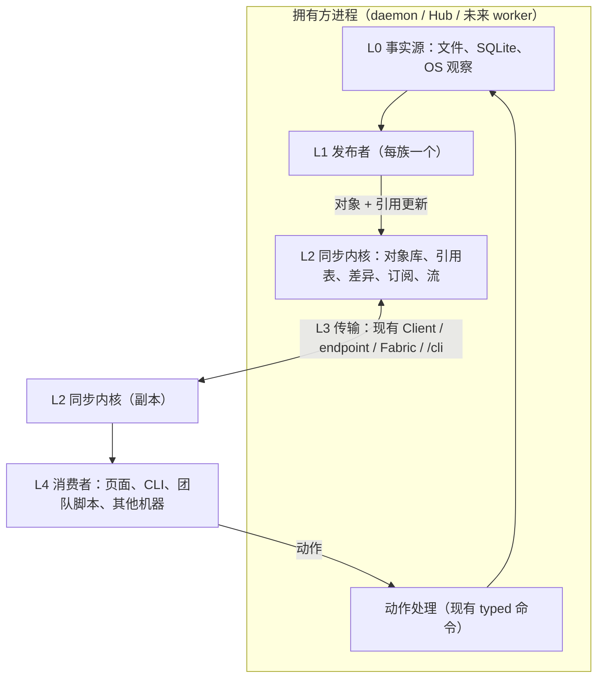

# GeneHub 统一信息同步架构 v3

> 2026-11-15 文档迁移：保留原文日期、事实基线与评审状态；源码行号为历史定位。迁移范围及工作区资料说明见[提案目录](README.md)。

> 已被 [v4 分层节点与校验 hash](unified-state-sync-architecture-v4-20261108.md) 取代：v4 去掉本文的不可变版本对象库、保留根、pin/回收和版本链，hash 只作校验值；数据源、关系、旅程与族映射沿用。

状态：待评审。本文只是提案，没有任何实现，也没有部署。日期：2026-11-08。

本文取代两份旧稿：
- [v2 目录提案](layered-file-hash-sync-proposal-v2-20261108.md)：其中的目录树设计并入本文，作为 P1 的一个发布者。
- [v1 综合提案](layered-file-hash-sync-proposal-20261108.md)：其中的接口审查与原型实验保留为历史证据。

源码基线：Open `origin/main` `193aa152`（dev-3 槽位 `432e507f`）；Cloud `e7dd53e`。

适用范围：GeneHub 全部"信息"的读取、变化传播、缓存和修改回执。
- 覆盖：daemon、浏览器、CLI、团队脚本、其他机器和 Hub。
- 不覆盖：实时媒体和信令（RTC、语音音频、服务预览画面），连接认证，以及软件包签名校验。这些继续由原有通道负责，原因见第 7 节。

## 摘要

**用户体验影响。** 下面这些现象看起来各不相同，根源其实是同一个：信息同步效率低。
- 浏览器重开慢，手机断线后恢复慢。
- 列表之间互相放大开销。
- 文件和 Git 面板不会自己更新。
- 团队脚本持续轮询，加重 daemon 负担。
- 跨机器的 CLI 调用每次都从头读取。

现在每一类信息各自发明了一套同步方式，例如自定义修订号、整份推送、按序号重放、只能手动刷新或持续轮询。共同的缺陷有四点：
- 没有可以跨进程比较的数据身份。
- 没有共享缓存。
- 读取时先构造全量再截取。
- 重连时必须上传已知清单，或者整份重传。

页面上的症状只是表象。

**怎么解决（待实施）。** 所有信息改用同一套同步机制：
- **原语只有四个**：对象（数据 hash）、引用、变化（事件 hash）、动作。
- **分为五层，每层只有一个所有者**。
- 每个业务模块只需写一个"发布者"，把自己的事实文件翻译成对象和引用。缓存、订阅、差异计算、断线恢复、有界传输和校验，全部由同一个同步内核提供。
- 页面、CLI、团队脚本、其他机器和 Hub 都是这个内核的消费者，走同一套协议。
- 旧的分族同步路径在对应阶段**一并删除**，不并行保留。旧版本兼容按用户要求简化。

**如何避免复发。** 共有三道防线：
- 内核有 8 条不变式（第 4 节），由一套共享的合同测试保证。
- 每一族都按同一张验收表核对（第 10 节），重点看三类场景：内容不变时重连、单次修改、故障恢复。
- 防回流测试禁止消费者绕过内核直接调用旧的读 RPC 或旧推送帧。

## 1. 问题本质：信息同步效率低

以下现状来自源码阅读，没有实测。

| 信息族 | 现在怎么同步 | 低效或不可靠之处 | 用户看到的现象 |
| --- | --- | --- | --- |
| 会话目录 | `catalog.sync`：内存修订号 + 浏览器上传已知清单（最多 12,000 项 etag），daemon 逐条重新投影 | 重连成本随历史量线性增长；daemon 重启后修订号失效，只能整份修复 | 重开或重连慢 |
| 会话正文 | `subscribe sinceSeq` 重放 + 快照；`inspect/narrative/rounds/context` 先由 `read_view` 克隆并编码全量，再截页 | 读一页的成本随整段历史增长；重放窗口有限，超出后只能整份快照 | 长会话打开慢，手机恢复慢 |
| Agent、进程 | `AgentsChanged`、`BackgroundProcesses` 每次推送整份列表 | 任何一项变化都要重传全表 | 多 Agent、多进程时流量大 |
| 文件、Git | `file.tree`、`git.status` 只在挂载或手动点刷新时请求，没有变化通知；目录上限 2,000 项、树上限 10,000 节点，截断时不提示 | 外部改动看不到；截断后的结果被当成完整 | 面板内容过时，要手动刷新 |
| PTY、日志 | `PtyOutput` 推送原始字节帧；日志按尾部读取 | 断线后无法按内容续接 | 终端重连后丢输出 |
| 设置、设备、更新、Hub | 请求一次、响应一次，页面各自按时机重读 | 没有统一的变化通知 | 不同页面看到的状态不一致 |
| CLI、团队脚本 | `session list --lean` 等命令翻页到末页；`board.py` 周期性读取完整活动集合 | 轮询；每个进程重复读取同一份数据 | 团队规模越大，daemon 越忙 |
| 跨机器 | 每次 `--machine` 都经 Fabric 完整请求一遍，没有本地副本 | 重复读取叠加往返延迟 | 多机协作慢 |
| 浏览器缓存 | 只缓存目录；每次变化都把整个来源重新编码、计算 checksum 后写入 | 写入放大；其他信息族完全没有缓存 | 只有目录能离线显示 |

证据位置：
- [catalog.rs](../../apps/daemon/src/session/catalog.rs) 第 279–387 行。
- [rpc.rs](../../packages/proto/src/rpc.rs) 中的 `ServerFrame`（第 1326 行起）。
- [FilesPanel.tsx](../../packages/workbench/src/files/FilesPanel.tsx)、[ChangesPanel.tsx](../../packages/workbench/src/changes/ChangesPanel.tsx)。
- [summary-directory-cache.ts](../../packages/workbench/src/protocol/summary-directory-cache.ts)。
- v1 [接口审查](layered-sync-interface-audit-20261108.md) 第 334–362 行中的第 3、6、8、9 条。

**共同根因有四个：**
1. **没有统一的数据身份。** 修订号只在一个进程内有效，etag 只覆盖某一种数据，所以重启或跨进程后无法判断"我手里的是否还是最新的"。
2. **没有分层读取。** 只想要一个小头部，也要先构造整份数据。
3. **没有统一的变化传播。** 有的族整份推送，有的族要求手动刷新，有的靠轮询。
4. **没有共享缓存。** 浏览器、CLI、团队脚本和其他机器各自重复读取同一份数据。

## 2. 目标

| 目标 | 可观察的标准 |
| --- | --- |
| 内容不变时核对的成本只与订阅数量有关 | 重连时一个请求，内容随所订阅引用的数量增长，与历史长短、成员多少无关 |
| 修改的成本只与改动大小有关 | 一次修改只传输从该对象到根这条路径上的节点 |
| 读取只付所读层级的代价 | 读会话头不触碰正文，读最后一页不构造整段历史 |
| 没有轮询 | 所有信息族都通过变化事件推送；CLI 和团队脚本通过 `--watch` 订阅 |
| 重启或断线不需要全量重传 | 内容没变，hash 就相同，不传任何对象 |
| 一次写好，处处复用 | 新信息族只需写一个发布者，就自动获得缓存、订阅、恢复、分页和校验 |
| 可靠 | 第 4 节的 8 条不变式都有合同测试覆盖 |

## 3. 架构：四个原语，五层



| 层 | 唯一所有者 | 只负责 | 不负责 |
| --- | --- | --- | --- |
| L0 事实源 | 现有业务模块（Store、registry、文件系统、进程、Hub SQLite） | 持久事实和原子写入 | 不保存 hash 树，也不负责同步 |
| L1 发布者 | 每个信息族一个，与 owning 模块放在一起 | 把事实翻译成对象和引用；在提交点或观察到变化时发布 | 不实现缓存、订阅、重试或传输 |
| L2 同步内核 | 一份合同，有 Rust（daemon、CLI、未来的 Hub/worker）和 TS（浏览器）两个实现 | 对象库、引用表、差异计算、订阅、流、有界传输、闭包检查、校验、回收 | 不理解业务字段 |
| L3 传输 | 现有 Client、endpoint、Fabric、`/cli` | 承载 4 种同步帧和现有的动作 RPC | 不新增连接，也不改认证 |
| L4 消费者 | 页面、CLI、团队脚本、其他机器 | 选择要订阅的引用和读取深度，解码 payload，渲染或输出 | 不持有第二份业务事实，不直接调用旧的读 RPC |

**四个原语。** 它们作用在第 3.2 节定义的"实体"之上。实体是会变化的业务事物，例如会话、项目、会话列表；原语本身不是实体。

| 原语 | 定义 | 对应的核心约束 |
| --- | --- | --- |
| 对象 Object，即"版本对象" | 某个实体的某种表示在某一时刻的不可变快照，`id = SHA-256("gh1\n" + bytes)`。实体变化时生成新版本，旧版本不改 | 数据 hash |
| 引用 Ref | 订阅入口实体的"当前版本"指针 `name → root`，只有一个写者。内层实体的当前版本沿树路径找到 | 数据分层的入口 |
| 变化 Change | `{ref, base, root}`，`changeId = SHA-256("gh1c\n" + ref + base + root)` | 事件 hash |
| 动作 Action | 发给拥有方的 typed 命令；回复携带它产生的 Change | 修改的唯一入口 |

**流（Stream）不是第五个原语，而是引用的一种用法：**
- 流的根是一个分段索引对象，指向已经封存的段（这些段都是对象）。
- 还没封存的活动尾部按 `seq` 实时追加。
- 会话时间线、PTY 输出、日志、`shell.run` 输出都统一用这种方式。

### 3.1 数据源：四类，各有不同的变化检测规则

数据源远不止文件。按"谁写、能否持久、怎样得知变化"分成四类，同步可靠性的差别主要就来自这里。以下内容来自源码阅读：

| 类别 | 具体数据源（现有位置） | 怎样得知变化 | 可靠性边界 |
| --- | --- | --- | --- |
| A 持久事实：daemon 自己写 | **会话 `meta.json`**：标题、标题锁、标签、描述、归档、Agent、模型/模式/effort/运行参数、cwd、草稿、待处理权限、人工续接、inbox、执行围栏与清理回执、lineage、导入信息。这些字段在同一文件里，是一个原子单位（`SESSION_FORMAT=10`）。<br>**会话内容**：`chat.jsonl`、`rounds/r-NNN/index.jsonl`、`t-NNNN.jsonl`、`blobs/`、`images/`、`artifacts/`。<br>**工作区 registry**（daemon 配置）：id、name、root、folders、`workspace_file`、removed、`is_git_repo`。<br>**Space 描述** `agent-space.genet.json`、`.code-workspace`。<br>**配置**：Agent registry、provider、settings、fileAccess、speech。<br>**其他**：设备存储、预览批注、诊断环 | 在写入点直接发布，例如 `Store::save_meta`、`append_round`、`write_trunk`、registry 保存 | 最可靠：提交和发布在同一进程内完成 |
| B 外部事实：别人写，daemon 只能观察 | **项目文件夹本身**：是否存在、名字（重命名或移动）、所在卷是否离线、权限。注意工作区名默认在注册时取自文件夹名并复制进 registry（`workspace.rs` 第 1580–1585 行），之后不再跟随文件夹变化。<br>**项目内文件、Git 工作树/HEAD/index**。<br>**其他程序写的 Space 描述**，例如 PipeBuilder。<br>**团队协调器定时写出的协调投影**（`coordination.rs`）。<br>**Hub 侧**：账号、机器、placement（Cloud SQLite） | 有订阅时启用 watcher；订阅时对账一次；对账有预算。Hub 在其事务提交点发布 | 可能晚到，可能漏报。必须带"观察时间"，可以标为未知 |
| C 运行观察：内存中，重启即失 | 会话 Live 状态（Running/Waiting/Idle/Failed）、activity、内存中的待处理权限、`agent_pid`；进程、PTY、Shell 实例；机器在线状态与连接；daemon 版本；语音 runtime 状态 | 状态跳变时发布。重启后带新的 epoch 重新观察 | 只在拥有方实例存活期间有效。副本只能称之为"最后看到的状态" |
| D 派生视图：由 A、B、C 计算 | **会话摘要** = meta + Live + 协调投影 + 待处理交互（`project_meta`）。<br>**预览与最新回复**。<br>**是否活动**（`is_active`）与活动集合。<br>**项目状态卡**：运行、待处理、团队、Git 是否有改动。<br>**显示名**：工作区优先用 registry.name，其次文件夹名；会话标题缺省时由首条消息派生。<br>**排序、筛选、计数** | 任一输入变化时，由发布者按依赖表重算（见 3.3） | 只要输入版本对，派生就对；派生物不另行持久化 |

**规则：**
- A 类在写入点发布。
- B 类必须有观察时间，并且允许"未知"。
- C 类带拥有方的实例 epoch，不被当作持久事实。
- D 类不单独持久化，可以随时从输入重建。

同一个实体常常同时依赖几类数据源。例如会话摘要同时依赖 A、B、C 三类，所以它的可靠性取决于其中最弱的那个输入。这正是摘要必须由发布者统一派生、不能让各消费者各算一份的原因。

### 3.2 实体、版本与引用：会变的东西怎么办

**对象不可变，但会话、项目、会话列表都会变。** 这并不矛盾，因为它们分属两个概念：

- **实体**：有稳定 ID、随时间变化的业务事物。例如会话 `s_1`、项目 `w_1`、某台机器的会话列表、某个目录 `files/w_1/src`、Agent 列表。会话列表和项目当然都是实体。
- **版本对象**：实体在某一时刻的某种表示。内容一旦生成就不再改变，用 hash 标识。
- **当前版本**：实体"现在是哪一版"。订阅入口实体由引用直接记录；内层实体由父版本里的 hash 链接记录。

实体每变化一次，就生成一个新的版本对象，指针随之移动；旧版本原样保留，供在途读取使用，没有人引用后再回收。这和 Git 相同：文件路径是实体，每次提交生成新的 blob，分支是引用。

**示例：会话 `s_1` 改名，A 改为 B。**

```text
改前  dir@R1 ─ w_1.sessions@P1 ─ bucket[17]@K1 ─ s_1.summary@S1(title=A)
改后  dir@R2 ─ w_1.sessions@P2 ─ bucket[17]@K2 ─ s_1.summary@S2(title=B)
```

- 新生成 4 个版本对象（S2、K2、P2、R2），每个只有几百字节到几十 KB。
- 其余 63 个桶、其他工作区、所有其他会话摘要全部复用原版本。
- 正在读 R1 的页面不会读到"一半旧、一半新"的数据。
- 订阅者收到一条 `R1 → R2` 的变化，只需补齐这 4 个对象。

**为什么版本必须不可变：**
- 版本不会变，缓存就永远不会"内容失效"，唯一需要核对的是"当前指向哪一版"。
- 相同内容在任何进程、任何时间都得到同一个 hash，所以重启、跨机器都能直接比较。
- 读取方可以 pin 住一个根，读到一致的快照。
- 两个根的差异就是"新树里有、旧树里没有"的对象，不需要变化日志。

**一个实体按变化频率和读者拆成多种表示，每种表示有自己的版本链：**

| 实体 | 表示 | 变化频率 | 主要读者 |
| --- | --- | --- | --- |
| 会话 | 摘要（标题、状态、预览、计数） | 改名或状态跳变时 | 列表、活动集合、CLI list |
| 会话 | 状态（inbox、待处理权限、续接、协调） | 输入、权限、任务变化时 | 打开的会话、PM |
| 会话 | 时间线（流） | 逐 token 追加尾部；按轮次封存 | 打开的会话、`narrative` |
| 项目 | 头部（名字、根、文件夹、Space 组合、rootMissing） | 配置、发现、文件夹观察变化时 | 列表、项目页 |
| 项目 | 状态卡（派生） | 成员会话或团队状态变化时 | 项目页、看板 |
| 文件目录 | 清单（条目名、类型、大小、mtime） | 外部写入或动作时 | Files 面板、CLI |

**不进入版本的东西：**
- 相对时间（"3 秒前"）由消费端根据绝对时间计算。
- 心跳、在线探测时间、token 计数放在控制信封里，或只在状态跳变时更新。
- 否则版本会不停变化，hash 就失去复用价值。

**不是每个实体都需要自己的引用。** 只有订阅入口需要，例如 `dir`、`session/<id>`、`workspace/<id>`、`agents`、`files/<ws>/<path>`。列表里某条会话摘要的当前版本，沿 `dir` 的树路径就能找到。这样引用数量可控，内层变化也会自然冒泡到入口的根。

### 3.3 关系：三种关系，三种链接方式

| 关系 | 含义 | 怎么链接 | 例子 | 理由 |
| --- | --- | --- | --- | --- |
| **包含（层级、所有权）** | 子实体属于且只属于这个父实体，随父实体一起删除 | 父版本里写入子版本的 **hash**，形成一棵树，子变化会冒泡到根 | 机器目录 → 项目 → 会话桶 → 摘要；会话 → 轮次索引 → trunk → blob；目录清单 → 子目录清单 → 文件块；`agents` → 各 Agent | 一个根 hash 就能核对整棵子树；差异计算是天然的；树结构不会出现循环 |
| **关联（引用另一个实体）** | 指向一个独立存在的实体，生命周期各自独立 | 只写目标的**稳定 ID**，不写 hash；跨拥有方时还要带上拥有方，例如 `machineId + sessionId` | `session.workspaceId`、`session.agentId`、lineage/fork 的父会话、团队成员会话、制品属于哪个会话、Hub placement ↔ daemon workspace、PM 任务 → Worker 会话 | 改一个 Agent 的名字，不应该让所有引用它的会话都生成新版本；父子会话互相引用时，用 hash 会形成循环。目标消失时，显示"不可用/未知"，不级联删除 |
| **派生（依赖、计算）** | 一个表示由若干输入计算得到 | 发布者声明**依赖表**：输入变化时重算哪些表示。派生结果本身就是普通的版本对象 | 会话摘要 ← meta + Live + 协调 + 交互；活动集合 ← 全部摘要的 `isActive`；项目状态卡 ← 成员摘要 + 团队协调 + Git 观察；显示名 ← registry.name 或文件夹名 | 让各消费者自己算会重复且不一致；只由一处计算，才能保证 CLI、页面和团队看到的是同一结论 |

**补充规则：**
- **只在同一拥有方内做派生。** 跨拥有方的组合，例如"Hub placement + 某台机器的工作区"、"三台机器的活动总数"，在消费端用 ID 关联现算，不持久化。某个来源未知时，汇总结果明确标"缺源"，不当作 0。
- **索引和视图是派生物，不是成员分桶。** 排序和筛选只依赖条目字段（如 `updatedAtMs`）。页面在本地排序；CLI 分页由 daemon 内存索引提供。这些都不进入成员树的结构。
- **依赖表从小处开始，必须显式写出。** 每个发布者用一张表写清"输入 → 受影响的表示"，例如"`meta.title` 变化 → 摘要"，"Live 状态变化 → 摘要和活动集合"。不做通用表达式语言或计算图。
- **身份不能混用。** Hub 工作区 ID、daemon 工作区 ID、根路径、文件路径是不同的标识，只能通过关联字段映射，不能互相替代（见 v1 审查第 11 条）。文件夹改名或移动后，实体 ID 不变，只有它的 `root` 属性和观察状态变。

### 3.4 体验旅程验证

| 旅程 | 涉及的数据源 | 实体与关系 | 同步时发生什么 | 现在的问题 |
| --- | --- | --- | --- | --- |
| 1. 打开工作台，看到三台机器的项目和会话 | A registry、A meta、C Live、D 摘要和显示名、Hub 机器 | 每台机器一个 `dir` 根（包含关系）；Hub 机器列表与 daemon 用 ID 关联 | 先显示缓存里每台机器的根（上次状态）；每台机器核对一个 hash；一台离线时只标它为未知 | 上传已知清单；整份写缓存；多套目录 |
| 2. 进入项目页，看团队进展 | A registry、B 协调投影、B Git、D 状态卡 | `workspace/<id>` 头部与状态卡；成员会话用 ID 关联 | 订阅项目入口；成员摘要从 `dir` 复用，不重复下载 | 各面板各自请求，状态不一致 |
| 3. 打开一个 3,000 轮的会话并继续对话 | A chat/rounds/trunk、C Live | `session/<id>`：头部、状态、时间线流（包含关系） | 只取最后几个段和尾部；发送消息是动作（`messageId`）；inbox 接收后状态生成新版本 | 先构造全量历史再截页 |
| 4. Agent 在后台请求权限 | C 待处理权限、A `meta.pending_permission`、D 摘要和活动集合 | 状态 → 摘要 → 活动集合 → `dir` 根（派生加包含） | 一次变化沿依赖表更新 3 个表示并冒泡到根；所有订阅者在同一个推送里收到 | 依赖轮询或整份推送 |
| 5. 用户在 Finder 里把项目文件夹改名 | B 文件夹存在性与名字；会话就存放在该文件夹的 `.genethub/sessions/` 里 | 工作区实体 ID 不变；`root` 属性和"rootMissing"观察变化；会话实体通过包含关系一起变为未知 | 对账时发现根路径不存在，项目头部生成新版本（rootMissing），会话显示未知而不是被删除；用户重新定位是一个动作，registry 更新后会话重新出现 | 现在没有观察者；显示名停留在注册时的文件夹名，用户看不出原因 |
| 6. 外部编辑器改了文件，或执行了 `git checkout` | B 文件、B Git | `files/<ws>/<path>` 清单（包含）；`git/<ws>` 观察 | 有订阅时 watcher 触发，只更新改动的目录清单和 status 对象 | 必须手动刷新；截断时不提示 |
| 7. PM 脚本看全队状态 | D 摘要、B 协调投影 | 成员会话用 ID 关联，跨机器时带 `machineId` | `--watch` 订阅 `dir` 和项目入口，空闲时没有流量；远端机器由本地副本提供 | `board.py` 周期性读取完整活动集合 |
| 8. 手机断线 10 分钟后恢复 | 全部 | 已订阅的入口 | `sync.open` 带上各入口的已知根；拥有方保留了最近的根，一次往返返回差异；时间线从 `tailSeq` 续接 | 已知清单上传或整份快照 |
| 9. 把会话 fork 到另一台机器 | A lineage | 新会话用 `machineId + sessionId` 关联父会话 | 父会话变化不影响子会话的版本；父会话不可达时显示"来源不可用" | 关联语义分散在各处 |
| 10. 改一个 Agent 的显示名 | A Agent registry | 会话只通过 `agentId` 关联 Agent | 只有 `agents` 生成新版本；会话列表展示时按 ID 取 Agent 名；不会有一万条会话同时变化 | 若把名字嵌入摘要，就会全量失效 |

这些旅程说明了三点：
- 包含关系决定了"核对一个 hash 能证明什么"。
- 关联关系把变化的影响限制在实体自身。
- 派生依赖表决定了"一个事实变化后要更新哪些表示"。

这三条规则是每个发布者都要填写的内容，也是评审发布者时的检查清单。

## 4. 原语细节与内核不变式

**对象编码有两种：**
- **节点**：daemon 用 serde 生成 `{"k":kind,"l":[childId...],"p":payload}` 形式的 UTF-8 JSON 字节。内核只读 `l` 做遍历，`p` 交给消费者按 `k` 解码。
- **原始块**：字节本身，没有子引用，例如已封存的 trunk 文件、blob、文件内容块。

**hash 只由生产者计算。** 副本按 id 原样保存字节，用 SHA-256 校验，从不重新编码。
- 因此 Rust 和 TS 之间不需要规范 JSON，f64、u64 和键排序都不会造成 hash 不一致。
- 同一发布者对相同输入必须产生相同字节。实现上用固定结构体加 `BTreeMap`，并有确定性测试保证。

**大集合按固定规则分层：**
- 成员按 `SHA-256(稳定ID)` 前缀分桶，每层 64 路，桶超过 1 MiB 才再分一层。
- 顺序信息（如 `updatedAtMs`）作为字段放进条目，不按展示顺序分桶。这样插入一项不会改动其他桶。
- 追加型序列（轮次、日志段）用"每 256 个封存成一个索引节点"的追加树。已满的节点不再改变，只有最后一个节点会变。

**内核不变式（由合同测试覆盖）：**
1. **单一写者**：每个引用只有拥有方能更新，而且只能在其事实提交之后或观察到变化之后更新。
2. **对象不可变**：每经过一个边界都用 hash 校验，不符就丢弃并重取。
3. **基准匹配**：副本只在 `base` 等于本地根时才应用一个 Change；否则用 `sync.get` 补齐，不可能悄悄漏掉更新。
4. **闭包后切换**：副本只在消费者声明的所需深度全部闭合（所需对象都在本地并已校验）后才切换根；中途中断时保留旧根。
5. **有界进展**：每个响应和推送都有字节数与对象数上限，用 `more` 明确表示还有后续；单个对象最大 1 MiB。
6. **未知不等于空**：拥有方不可用、读取范围出错或容量超限时，引用标为 `unknown` 并附原因；副本保留上次内容，不当作删除。
7. **动作语义**：回复区分 `committed / rejected / unknown`。"设为某值"类操作可以安全重试；非幂等操作沿用现有的 `messageId`/`creationId`/provider `actionId`；结果为 `unknown` 时不自动换 id 重发。
8. **重启无损**：拥有方重启后从 L0 重建；内容相同时根 hash 相同，副本不需要重传。

内核不需要修订号、持久事件日志或跨进程时钟。只有流的活动尾部带 `seq`，因为逐 token 计算 hash 没有意义。

## 5. 协议：4 种同步帧

同步帧在现有连接上承载，本地 CLI、浏览器、Fabric 远端和 Hub 都用同一格式。

```json
{"type":"sync.open","payload":{"subs":[
  {"ref":"dir","known":"sha256:…","depth":2},
  {"ref":"session/s_1","known":"sha256:…","depth":1,"tailSeq":8812}]}}
```

```json
{"type":"sync.changes","changes":[{"ref":"dir","base":"sha256:A","root":"sha256:B","id":"sha256:C"}],
 "objects":[{"id":"sha256:…","bytes":"…"}],"unknown":[],"more":false}
```

```json
{"type":"sync.get","payload":{"want":["sha256:…"]}}
```

```json
{"type":"sync.append","ref":"session/s_1","seq":8813,"data":"…"}
```

**规则：**
- **`sync.open`** 用来订阅引用，可以用前缀，例如 `session/s_1/*`。对每个订阅：
  - `known` 等于当前根时，回 `unchanged`。
  - `known` 在拥有方保留的最近 8 个根之内时，直接附带差异对象。
  - 其他情况只附带根对象。
  - 对流还要按 `tailSeq` 补发尾部；尾部已经封存的部分改走 `sync.get` 取段。
- **`sync.get`** 只能取当前订阅引用可达的对象，hash 本身不授予权限；不可达的 id 放进 `unknown`。
- **`sync.changes`** 是推送，可以批量合并，并附带有界的预取对象。断线重连后先发 `open`，因此不需要心跳携带根。
- **`sync.append`** 只用于流的活动尾部，到达即发送，不做合并，保持现有时序和背压。PTY 输入、发送消息等仍然是动作。
- **动作**仍是现有的各族 typed RPC，只在回复中增加 `changes` 字段，调用方据此立即更新本地副本。

**传输预算**：每个响应或推送最多 256 KiB、512 个对象，单个对象可以独占一个响应。慢消费者触发现有 Writer 背压；积压超出预算时，对该订阅发出 `reset`，副本随后重新 `open`。

**授权**：已认证的完整连接可以读该 OS 用户名下的全部引用，这与现有产品权限合同一致。只读展示分享只能读分享范围内的引用。

## 6. 发布者合同

每个信息族需要填写以下几项。其中实体、包含、关联和依赖四项，就是第 3.2–3.3 节要求的内容：

```text
publisher session:
  sources:   A meta.json / chat.jsonl / rounds / blobs；C Live 状态与内存权限；B 协调投影
  entities:  会话（摘要、状态、时间线三种表示）、会话列表
  contains:  dir → 工作区会话桶 → 摘要；session/<id> → 轮次索引 → trunk → blob
  links:     workspaceId、agentId、lineage(machineId + sessionId)
  depends:   meta.title|labels|archived → 摘要；Live 状态 → 摘要 + 活动集合；
             协调投影 → 摘要 + 状态；inbox/待处理权限 → 状态 + 摘要
  refs:      dir, session/<id>, session/<id>/timeline (stream)
  build:     从 L0 读取并生成版本对象（启动时或按需惰性生成）
  publish:   在 Store::save_meta、append_round、write_trunk、Live 状态变化、协调投影变化处
             调用 kernel.update(ref, changedObjects)
  actions:   现有 session.* typed 命令；回复附带 kernel 返回的 changes
```

评审发布者时逐项检查：每个数据源都有变化检测方式；B 类和 C 类有观察时间或 epoch；关联字段只写 ID；依赖表覆盖了所有派生字段。

内核提供的 API 只有以下几个：

```text
update(ref, objects, root)                 # 拥有方发布
append(ref, seq, data) / seal(ref, segment) # 流
open(subs) / get(ids) / close(subs)         # 消费方
pin(root) / unpin                           # 在途读取的生命周期
```

**惰性生成**：对象不必常驻内存。已封存的文件，例如 trunk 和 blob，其文件字节本身就是原始块对象。内核只缓存 `(路径, 大小, mtime, inode) → id` 这个提示；真正读取时重新计算 hash 校验，提示失效就重算。内存预算超出时，内核淘汰可以重建的对象，不淘汰引用和被 pin 住的根。

## 7. 全部信息族的映射

27 个方法族逐一归入下表；数量与所有者见 [v1 接口审查](layered-sync-interface-audit-20261108.md) 第 11–41 行。

| 信息族（v1 审查中的族名） | 引用与对象树 | 变化来源 | 被替换的旧路径 |
| --- | --- | --- | --- |
| 会话目录（`catalog`、`session.list/page`） | `dir`：工作区 → 会话桶 → 摘要；外加活动集合、错误 | `save_meta`、Live 状态、协调投影、registry | `catalog.sync`、`Catalog` 帧、已知清单、浏览器目录缓存、前端第二份目录、页面翻页循环 |
| 会话（`session`、`round`、`blob`、`subscribe`、`unsubscribe`；后两者由 `sync.open/close` 取代） | `session/<id>`：头部、状态（inbox、待处理权限、协调）、时间线流（轮次索引 → trunk → blob） | `save_meta`、`append_round`、`write_trunk`、`Live::publish` | `subscribe sinceSeq` 重放、`history_snapshot`、`read_view` 全量构造、`Event` 帧、`inspect/narrative/rounds/context` 的读取实现 |
| 工作区与 Space（`workspace`、`agentSpace`、`fileAccess`） | `workspaces` → 工作区对象（配置、组合、placement） | registry 保存、Space 发现 | `workspace.list` 轮询、页面里分散的刷新 |
| Agent 与 Provider（`agent`、`provider`） | `agents` → Agent 对象（能力、状态、模型）；凭证不进入对象 | registry 生命周期、配置保存、provider 操作 | `AgentsChanged` 整份推送、`agent.list` |
| 设置与语音配置（`settings`、`speech` 配置部分） | `settings` → 分节对象 | 配置原子保存 | `settings.get` 重读 |
| 进程、PTY、Shell（`process`、`pty`） | `processes` → 进程对象；`pty/<id>` 为状态加输出流 | 进程注册表、PTY 回调 | `BackgroundProcesses` 整份推送、`PtyOutput` 帧 |
| 文件与目录（`file`、`directory`） | `files/<ws>/<path>` → 目录清单（条目含 stat，截断时带 `complete:false`）；文件为分块对象 | 只对有订阅的目录启用 OS watcher，订阅时对账一次；`file.write` 等动作 | 手动刷新、静默截断、`file.tree`/`directory.list` 的读取实现 |
| Git（`git`） | `git/<ws>` → status 对象、各文件 diff 对象 | watcher 监听 `.git/HEAD`、`.git/index` 和工作树变化，去抖 | `git.status` 手动刷新 |
| 日志与诊断（`log`、`diagnostics`） | `logs/<name>` 流；`diagnostics` 对象 | 追加写入、诊断环 | 尾部轮询 |
| 预览与制品（`preview`） | `preview/<id>` → bundle 清单（每个文件对应一个对象） | `artifact finish`、批注保存 | 重复下载 |
| 更新与设备（`update`、`device`） | `updates`、`devices` 展示对象 | 更新器回调、设备存储 | `update.status`/`device.list` 重读 |
| Hub（`hub` 与 Cloud HTTP） | Hub 拥有 `hub/machines`、`hub/placements`；可映射现有的 `workspace_catalog_heads` | Hub SQLite 事务提交 | Console 各页面自行请求 |

**不纳入本模型**的部分，以及原因：
- `connection.identity`、`caller`、`client.debug`：属于控制面。
- RTC、语音音频、`service.preview` 和远程桌面输入：属于实时媒体，按键与坐标有严格时序，不能按内容去重。
- 更新包签名与 ABI 校验：保证的是另一种安全性。

这些部分可以把自己的"状态摘要"发布成对象，但它们的数据通道不改。

## 8. 存储：结构友好的文件即对象

- **L0 不新增权威存储**，也不新建业务数据库。会话的现有布局已经是"追加日志 + 已封存块 + 内容寻址 blob"，格式 10 保持不变：
  - `chat.jsonl`、`rounds/r-NNN/index.jsonl` 是追加日志，对应流。
  - `rounds/r-NNN/t-NNNN.jsonl` 写定后不再改写，直接作为原始块对象。
  - `blobs/` 已经按内容 id 分桶，可以直接映射为对象。
- `meta.json` 仍然是输入义务、状态和回执的原子单位，它的投影进入 `session/<id>` 的头部和状态对象。只有测量证明它是热点时，才另立项拆分格式。
- daemon 侧的内核对象库放在内存里，有预算，可以随时从 L0 重建，不落盘。这样回滚和崩溃恢复都很简单。
- 浏览器副本使用 IndexedDB，包含两个 store：`objects`（id → 字节）和 `refs`（按"账号范围 + 机器 + 指纹"隔离，记录引用 → 根）。总预算 64 MiB；回收时从全部根出发做标记清扫；配额失败时退回内存。
- daemon 也可以作为其他机器的副本。它复用同一个对象库，只缓存远端引用，不缓存远端的写入权。
- Hub 仍以 SQLite 为权威，由发布者把它投影成对象，不复制成第二份事实。

## 9. 消费者

**页面**
- 只订阅当前视图需要的引用和深度。
- 启动时先从 IndexedDB 显示"上次状态"，再用 `sync.open` 核对，核对完成后标为"已核对"。
- 多台机器各自独立，一台离线不影响其他机器。
- `store.ts` 和 `MachineSummaryDirectory` 都退化为副本的读者，不再持有自己的目录副本。

**CLI**
- 命令面保持不变，例如 `session list/get/narrative`、`agent list`、`file tree`。内部改为通过本地 daemon 的内核读取，输出增加 `root`、`complete`、`unknown` 三个字段。
- 新增通用的 `--watch` 参数：先输出一次当前值，之后以 JSONL 逐行输出 Change，团队脚本据此取代轮询。
- `--machine X` 读取经由本地 daemon 中 X 的副本完成：第一次读取补齐对象，之后只需一次往返核对。

**团队脚本**
- `board.py`、`team.py` 改用 `--watch`。
- 用户机器上已部署的旧副本继续可用，因为命令面没变，只是收益较少。

**其他机器与未来的 worker**
- 走同一协议。worker 就是某些引用的拥有方，通过 IPC 承载同样的帧，前台代码不需要感知它在哪个进程。本文不承诺实现 worker，只说明边界已经留好。

## 10. 可靠性与效率验收（均未执行）

### 10.1 内核合同测试（Rust 与 TS 共用同一套用例）

| 场景 | 通过条件 |
| --- | --- |
| 确定性 | 同样的输入产生同样的字节和 id；TS 校验 Rust 产生的对象 |
| 内容不变时重连（10 个引用） | 1 个请求，回复小于 2 KB，拥有方读取 0 个 L0 文件 |
| 单次修改 | 只传输从改动处到根这条路径上的节点；其他桶没有写入 |
| 推送丢失或 `base` 不匹配 | 自动补齐并收敛到拥有方的当前根，没有漏项，删除项不会复活 |
| 拥有方重启，内容未变 | 回 `unchanged`，0 个对象 |
| 同步过程中又发生提交 | 先展示旧根并标为"旧"，之后收敛到新根 |
| 副本在写入中途崩溃 | 旧根保持可用；重启后从已写入的对象继续 |
| 对象损坏或被驱逐 | 校验失败或缺失后重取，不显示为完整 |
| 慢消费者 | 背压生效；超出预算时 `reset` 并重新 `open`；其他订阅不受影响 |
| `unknown` | 读取范围出错或拥有方离线时标为未知，副本保留上次内容 |
| 有界 | 任何响应都不超过预算，每次都有进展 |
| 流 | 断线后从 `tailSeq` 续接；超出尾部窗口时从段补齐；顺序与现有 `seq` 语义一致 |

### 10.2 分族验收（每族上线前必须通过）

| 族 | 通过条件 |
| --- | --- |
| 会话目录 | 10,000 条会话时，内容不变重连仍是 1 个请求；改一个标题，推送不超过 5 个对象 |
| 会话正文 | 读取 10,000 轮会话的最后一页时，处理量与最后一页大小相同；1,000 个 token 产生 0 条目录 Change |
| 文件与 Git | 在外部用编辑器或 `git checkout` 改文件，2 秒内面板更新；超过上限时明确显示"未完整" |
| 项目文件夹改名、移走或所在卷离线 | 下一次对账（订阅时或在预算周期内）后，项目显示为"根路径不可用"，其会话显示为未知且不被删除；重新定位后会话恢复，实体 ID 不变 |
| 关联与派生 | 改 Agent 显示名只生成 `agents` 的新版本，会话版本数为 0；Live 状态跳变一次，恰好更新摘要和活动集合，并冒泡出一个 `dir` 新根 |
| 进程与 PTY | 一个进程变化只推送一个对象；PTY 断线重连后输出不丢不重；输入延迟相对现状 p95 不增加 |
| Agent 与设置 | 改一项配置只推送对应分节；凭证不出现在任何对象中 |
| CLI 与团队 | 100 个并发读者时，同一版本的对象只构建一次；`--watch` 空闲时 daemon CPU 接近 0；`--machine` 第二次读取只需 1 次往返 |
| 多机 | 三台机器中 A 正常、B 慢、C 离线：A 正常显示，C 标为未知 |
| 防止旧路径回流 | 测试断言消费者代码不再调用已迁移族的旧读 RPC 和旧推送帧 |

字节数和请求数都是设计目标，每阶段需要用真实 daemon、浏览器和 WASM Host 测量后才能确认，不沿用 v1 原型的数字。

## 11. 迁移与删除

**兼容策略已按用户要求简化：**
- 新客户端只接 `sync.v1`；遇到旧 daemon 时提示更新，不再降级。
- 某一族迁移完成后，它的旧推送帧和旧读 RPC 立即删除。
- CLI 与 daemon 同一个二进制发布，命令面不变，因此用户项目里的脚本不受影响。
- 跨机器时两端都需要升级。
- 浏览器旧缓存直接删除，不做迁移。

**分期：**

| 阶段 | 交付 | 同时删除 |
| --- | --- | --- |
| P0 内核 | Rust 和 TS 内核、4 种同步帧、合同测试；`/cli` 与 Fabric 承载 | 无（先建立内核） |
| P1 会话 | `dir`、`session/<id>` 两个发布者与时间线流；页面和 CLI 会话命令改走内核 | `catalog.sync` 与 `Catalog` 帧、`subscribe` 重放与快照、`read_view` 全量读取路径、`summary-directory-cache.ts`、`store.ts` 的目录副本与全部 `catalog.sync.v1` 分支、五段翻页循环、页面中的 `session.list/page` |
| P2 运行态 | `workspaces`、`agents`、`settings`、`processes`、`pty/<id>`、`logs` | `AgentsChanged`、`BackgroundProcesses`、`PtyOutput` 帧，以及对应的读 RPC |
| P3 文件 | `files/*`、`git/*`、`preview/*`，外加 watcher 与对账 | 手动刷新入口、`file.tree`/`directory.list`/`git.status` 的读取实现 |
| P4 多机与 Hub | daemon 作为远端副本；Hub 发布者；Console 接入 | Console 各页面的自有请求与轮询 |
| P5 收尾 | CLI `--watch`；迁移团队模板 | `board.py`/`team.py` 中的轮询；v1 原型目录 |

**落地方式：**
- 每个阶段在 dev-3 的独立分支上实现，用现有 testctl 专项和真实浏览器验收，候选交给 release-beta 发布。
- P0 和 P1 必须一起作为第一个候选，因为 P1 是验证内核的第一个真实负载。
- 之后的每个阶段都能独立发布，删除的旧路径只限于该阶段已迁移的族。

**回滚**：L0 格式不变，内核状态全部可以重建，所以回退二进制即可，不涉及用户数据迁移。浏览器回到旧版时会冷启动一次。

## 12. 取舍与替代方案

| 方案 | 结论 |
| --- | --- |
| 继续分族各自优化 | 每族都要重新发明缓存、恢复和推送；症状修掉一个又冒出一个。这正是现状的根因 |
| 修订号加持久变化日志 | 短断线补齐很直接，但需要持久化、截断和处理重启，而且无法跨进程比较内容是否相同 |
| 事件溯源或 CRDT 多主合并 | GeneHub 每份数据都有明确的唯一拥有方，用不上多主合并，代价过高 |
| 本方案（类似 Git 的对象加引用，再加推送与流） | 原语最少，重启和跨进程天然一致，分层读取和缓存共享是自带的。代价是每次修改要重算路径 hash、保留 8 个根的内存，以及首次读取时的冷成本 |

## 13. 实施前必须测清楚的问题

1. **内核在 WASM Host 单线程下的开销。** 计算 hash 和差异必须按现有的 `WorkBudget` 分片让出 CPU。P0 要测出前台 p95 的变化。
2. **抖动源。** Live 状态、协调投影、Git 工作树在高负载下的变化频率是多少？是否需要每个引用 100–200 ms 的合并窗口？
3. **内存预算。** daemon 对象库加上保留根的 RSS 是多少？12,000 条会话、20 个打开会话时测量，并设定上限。
4. **watcher 的平台差异。** Linux inotify 有数量上限，macOS 是 FSEvents，Windows 是 ReadDirectoryChangesW。只对有订阅的目录启用 watcher，再配合订阅时的对账兜底。P3 必须覆盖三个平台。
5. **PTY 与流的延迟。** 改用 `sync.append` 后，输入回显的延迟不得增加。
6. **发布窗口。** 设备上 daemon 版本参差不齐期间，"需要更新"的提示必须可以操作。需要由 release-beta 确认窗口长度。
